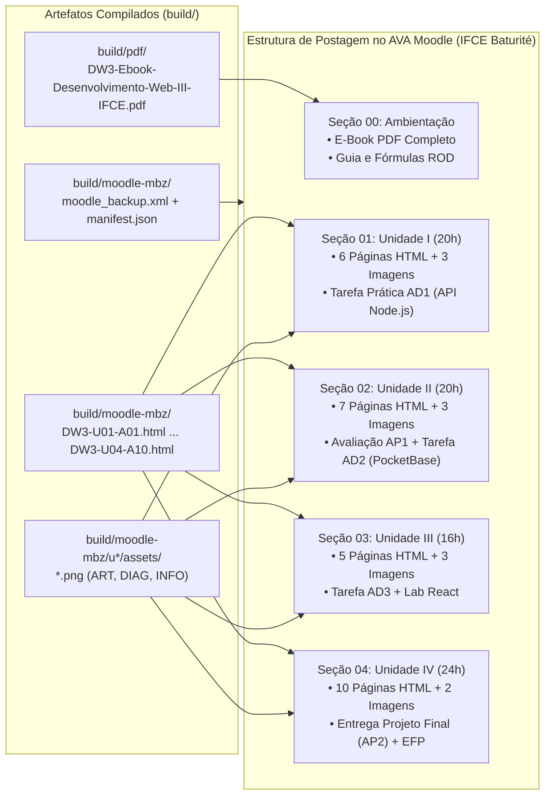

# Guia de Organização e Postagem no AVA Moodle (`dirtree`)
## Disciplina: Desenvolvimento Web III (UC17-DWIII)
### Instituto Federal de Educação, Ciência e Tecnologia do Ceará (IFCE) — Campus Baturité

---

## 1. Visão Geral da Estrutura no Moodle

Este documento especifica a árvore de organização (`dirtree`) para a publicação e importação dos artefatos gerados em `build/moodle-mbz/` e `build/pdf/` dentro da sala virtual do **Ambiente Virtual de Aprendizagem (Moodle)** do **IFCE Campus Baturité**.

A estrutura respeita integralmente a matriz curricular de **80 horas-aula (4 créditos)**, distribuídas em **16h presenciais**, **14h síncronas** e **50h assíncronas**, alinhada ao Regulamento da Organização Didática (ROD) do IFCE.

---

## 2. Diagrama de Árvore de Diretórios da Sala Virtual (`dirtree`)

```text
AVA-Moodle-IFCE-Baturite/
└── Curso: Técnico Subsequente em Informática para Internet (EaD)
    └── Disciplina: Desenvolvimento Web III (UC17-DWIII | 80h / 4 Créditos)
        │
        ├── 📌 [Seção 00] Ambientação, Guia de Estudos e Biblioteca Digital
        │   ├── 🖼️ Banner Principal do Curso (u1-backend-vibe/assets/DW3-U01-ART01.png)
        │   ├── 📄 Plano de Ensino e Critérios de Avaliação ROD/IFCE (docs/plan.md)
        │   ├── 📕 [Recurso: Arquivo PDF] E-Book Completo da Disciplina (build/pdf/DW3-Ebook-Desenvolvimento-Web-III-IFCE.pdf)
        │   ├── 🌐 [Recurso: Página/Índice] Mapa Geral de Aulas (build/moodle-mbz/index.html)
        │   └── 💬 [Atividade: Fórum] Fórum Geral de Avisos e Dúvidas Técnicas
        │
        ├── 🚀 [Seção 01] Unidade I: Framework Back-end (Node.js), Padrões & Vibe Coding (20h)
        │   ├── 🖼️ Rótulo/Banner de Abertura (u1-backend-vibe/assets/DW3-U01-ART01.png)
        │   ├── 📘 [Página HTML] Aula 01 (Assíncrona - 4h): Introdução ao Node.js e npm com IA (DW3-U01-A01.html)
        │   ├── 🧪 [Página HTML] Aula 02 (Presencial - 4h): Ambiente Node.js e HTTP na Prática (DW3-U01-A02.html)
        │   │   └── 🖼️ Diagrama Embutido: Fluxo Vibe Coding Back-end (DW3-U01-DIAG01.png)
        │   ├── 🎥 [Página + Webconferência] Aula 03 (Síncrona - 2h): MVC/Controllers e Scaffolding (DW3-U01-A03.html)
        │   │   └── 🖼️ Infográfico Embutido: Manual vs. Vibe Coding + Audit (DW3-U01-INFO01.png)
        │   ├── 📘 [Página HTML] Aula 04 (Assíncrona - 2h): Auditoria Crítica de Código Gerado por IA (DW3-U01-A04.html)
        │   ├── 🎥 [Página + Webconferência] Aula 05 (Síncrona - 2h): RESTful, Verbos HTTP e Exceções (DW3-U01-A05.html)
        │   ├── 💻 [Tarefa AD1] Aula 06 (Assíncrona - 6h): Exercícios Práticos de API REST em Node.js (DW3-U01-A06.html)
        │   └── 📦 Código-Fonte de Apoio (src/code-samples/u1-node-api/server.js)
        │
        ├── 🗄️ [Seção 02] Unidade II: Framework ORM, Persistência & PocketBase BaaS (20h)
        │   ├── 🖼️ Rótulo/Banner de Abertura (u2-orm-lowcode/assets/DW3-U02-ART01.png)
        │   ├── 📘 [Página HTML] Aula 01 (Assíncrona - 4h): Conceitos de ORM em Node.js e Entidades (DW3-U02-A01.html)
        │   ├── 🎥 [Página + Webconferência] Aula 02 (Síncrona - 2h): Chaves e Relacionamentos 1:N / N:N (DW3-U02-A02.html)
        │   │   └── 🖼️ Diagrama Embutido: Relacionamentos e API Rules (DW3-U02-DIAG01.png)
        │   ├── 📘 [Página HTML] Aula 03 (Assíncrona - 2h): Modelagem e Migrations Automáticas (DW3-U02-A03.html)
        │   ├── 📘 [Página HTML] Aula 04 (Assíncrona - 4h): Automação de Banco e PocketBase BaaS (DW3-U02-A04.html)
        │   │   └── 🖼️ Infográfico Embutido: Node.js ORM vs. PocketBase BaaS (DW3-U02-INFO01.png)
        │   ├── 🏆 [Avaliação Presencial AP1] Aula 05 (Presencial - 4h): Lab Node.js + PocketBase (DW3-U02-A05.html)
        │   ├── 🎥 [Página + Webconferência] Aula 06 (Síncrona - 2h): Queries Avançadas, Expand e N+1 (DW3-U02-A06.html)
        │   ├── 💻 [Tarefa AD2] Aula 07 (Assíncrona - 2h): Fixação de Tabelas e API Rules (DW3-U02-A07.html)
        │   └── 📦 Código-Fonte de Apoio (src/code-samples/u2-pocketbase-orm/pocketbase-client.js)
        │
        ├── ⚛️ [Seção 03] Unidade III: Front-end (JS Vanilla & React), Headless CMS & No-Code UI (16h)
        │   ├── 🖼️ Rótulo/Banner de Abertura (u3-frontend-nocode/assets/DW3-U03-ART01.png)
        │   ├── 📘 [Página HTML] Aula 01 (Assíncrona - 4h): Do JS Vanilla ao React e Reatividade (DW3-U03-A01.html)
        │   │   └── 🖼️ Infográfico Embutido: DOM Imperativo vs. Estado Reativo (DW3-U03-INFO01.png)
        │   ├── 📘 [Página HTML] Aula 02 (Assíncrona - 4h): PocketBase Headless CMS e UI v0/Figma (DW3-U03-A02.html)
        │   │   └── 🖼️ Diagrama Embutido: Integração React + REST + PocketBase CMS (DW3-U03-DIAG01.png)
        │   ├── 🎥 [Página + Webconferência] Aula 03 (Síncrona - 2h): APIs REST, useState e useEffect (DW3-U03-A03.html)
        │   ├── 💻 [Tarefa AD3] Aula 04 (Assíncrona - 2h): Requisições Fetch/SDK e Forms Reativos (DW3-U03-A04.html)
        │   ├── 🧪 [Laboratório Presencial] Aula 05 (Presencial - 4h): Dashboard Dinâmico em React (DW3-U03-A05.html)
        │   └── 📦 Código-Fonte de Apoio (src/code-samples/u3-react-frontend/dashboardLogica.js)
        │
        └── ☁️ [Seção 04] Unidade IV: Projeto Web Completo, Testes por IA & Deploy na Nuvem (24h)
            ├── 🖼️ Rótulo/Banner de Abertura (u4-projeto-deploy/assets/DW3-U04-ART01.png)
            ├── 🎥 [Página + Webconferência] Aula 01 (Síncrona - 2h): Escopo e Requisitos com SDD (DW3-U04-A01.html)
            ├── 📘 [Página HTML] Aula 02 (Assíncrona - 2h): Modelagem UI/UX e Rotas Protegidas React (DW3-U04-A02.html)
            ├── 📘 [Página HTML] Aula 03 (Assíncrona - 4h): Persistência, Auth JWT e Segurança OWASP (DW3-U04-A03.html)
            ├── 🎥 [Página + Webconferência] Aula 04 (Síncrona - 1h): Arquitetura BFF e Integração (DW3-U04-A04.html)
            ├── 📘 [Página HTML] Aula 05 (Assíncrona - 2h): Codificação Supervisionada e Git (DW3-U04-A05.html)
            ├── 📘 [Página HTML] Aula 06 (Assíncrona - 4h): Testes por IA (node:test) e Deploy Docker (DW3-U04-A06.html)
            │   └── 🖼️ Diagrama Embutido: Pipeline CI/CD, Testes IA e Cloud Deploy (DW3-U04-DIAG01.png)
            ├── 🧪 [Laboratório Presencial] Aula 07 (Presencial - 4h): Deploy em Nuvem e Teste de Carga (DW3-U04-A07.html)
            ├── 🎥 [Banca Síncrona] Aula 08 (Síncrona - 1h): Code Review e Apresentação de Projetos (DW3-U04-A08.html)
            ├── 🏆 [Avaliação Final AP2/AD4] Aula 09 (Assíncrona - 2h): Envio do Repositório no Moodle (DW3-U04-A09.html)
            ├── 📊 [Fechamento & Exame EFP] Aula 10 (Assíncrona - 2h): Diário de Classe e Exame Final (DW3-U04-A10.html)
            └── 📦 Suíte de Testes & Container (src/code-samples/u4-fullstack-tests/api.test.js & Dockerfile)
```

---

## 3. Fluxo de Mapeamento (`Repositório SDD` ➔ `Tópicos do Moodle`)



---

## 4. Matriz de Recursos Moodle e Rastreabilidade de Frequência (ROD / IFCE)

| Tipo de Aula na Árvore | Recurso Nativo no Moodle | Arquivo de Origem no Build | Critério de Conclusão e Presença Computada |
| :--- | :--- | :--- | :--- |
| **Ambientação / E-Book (`📕`)** | Recurso **Arquivo (`mod_resource`)** | `build/pdf/DW3-Ebook-Desenvolvimento-Web-III-IFCE.pdf` | Download/leitura offline do material integral das 4 unidades. |
| **Assíncrona Teórica (`📘`)** | Recurso **Página (`mod_page`)** | `build/moodle-mbz/DW3-U0X-A0Y.html` | Conclusão automática ao visualizar a página + entrega das Atividades a Distância (**AD**). |
| **Assíncrona Prática (`💻`)** | Atividade **Tarefa (`mod_assign`)** | `DW3-U01-A06.html`, `DW3-U02-A07.html`, `DW3-U03-A04.html` | Submissão de código/repositório pelo discente (compõe a nota **AD** e frequência assíncrona). |
| **Síncrona (`🎥`)** | Recurso **Página (`mod_page`)** + **URL Webconferência** | `U01-A03/A05`, `U02-A02/A06`, `U03-A03`, `U04-A01/A04/A08` | Participação ao vivo nos momentos síncronos (**14h** totais) ou acesso à gravação. |
| **Presencial / Lab (`🧪` / `🏆`)** | Recurso **Página (`mod_page`)** + **Avaliação (`AP1` / `AP2`)** | `DW3-U01-A02.html`, `DW3-U02-A05.html`, `DW3-U03-A05.html`, `DW3-U04-A07/A09.html` | Presença física registrada no laboratório do *Campus* Baturité (**16h** totais) + nota **AP**. |
