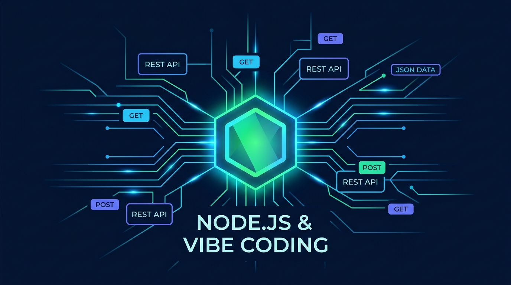

# Aula 01: Introdução ao Node.js, Frameworks Web e Gerenciamento de Pacotes com IA



## 1. Objetivos de Aprendizagem

Ao concluir esta aula assíncrona, você será capaz de:
- [x] **Explicar** o funcionamento do runtime **Node.js**, a engine V8 e o modelo de I/O não bloqueante orientado a eventos (*Event Loop*).
- [x] **Diferenciar** a escrita de código em **JavaScript Vanilla (ES6+)** no navegador e no servidor utilizando *ES Modules* (`import` / `export`).
- [x] **Estruturar** um projeto back-end com `npm`, configurando o manifesto `package.json` e utilizando **Vibe Coding** para geração e auditoria de configurações iniciais.

---

## 2. Fundamentação Teórica (Markdown)

### 2.1 Do Navegador ao Servidor: O Ecossistema Node.js
Historicamente, o **JavaScript Vanilla** nascia restrito ao contexto do navegador para manipulação do DOM. Com a criação do **Node.js** sobre a engine **V8** (do Google Chrome) combinada à biblioteca `libuv`, o JavaScript consolidou-se como uma linguagem *full-stack* de alta performance para servidores Web e APIs RESTful.

Diferente de servidores tradicionais que alocam uma *thread* pesada do sistema operacional para cada requisição HTTP recebida, o Node.js opera sob o modelo **Single-Threaded Event Loop** com I/O assíncrono não bloqueante:
1. A requisição HTTP chega ao Event Loop.
2. Operações custosas de entrada/saída (consulta ao banco SQLite/PocketBase, leitura de arquivos ou chamadas de rede) são delegadas de forma assíncrona (`Promises` e `async/await`).
3. O processo principal continua livre para atender centenas de outros clientes simultaneamente.

### 2.2 Frameworks Web em Node.js e Gerenciamento de Pacotes (`npm`)
Embora o módulo nativo `node:http` forneça toda a base de rede para criar servidores Web sem dependências externas, frameworks minimalistas (como **Express** e **Fastify**) adicionam camadas ergonômicas de roteamento, *middlewares* e serialização JSON.

O **Node Package Manager (`npm`)** centraliza a gestão de bibliotecas por meio do arquivo `package.json`. Na abordagem moderna adotada nesta disciplina, ativamos o suporte nativo a **ES Modules** definindo `"type": "module"`, o que unifica a sintaxe `import/export` entre o back-end Node.js e o front-end React.

### 2.3 Vibe Coding no Setup Arquitetural
No paradigma de **Desenvolvimento Orientado a Especificação (SDD)** e **Vibe Coding**, o desenvolvedor não perde tempo memorizando flags obscuras de configuração: ele especifica requisitos técnicos claros (versão da engine Node, scripts de execução com `--watch`, política de módulos ES6 e dependências estritamente necessárias) e audita o artefato gerado pela IA.

---

## 3. Atividade Prática Guiada (Hands-on)

### Passo 1: Prompt de Especificação para Inicialização do Projeto (Vibe Coding)
Utilize o seguinte prompt estruturado no seu assistente de código (Cursor, GitHub Copilot ou Gemini Code Assist):

```text
[SPEC-PROMPT]: Gere um arquivo package.json para uma API acadêmica do IFCE Campus Baturité em Node.js 20+, utilizando ES Modules ("type": "module"), sem dependências externas desnecessárias, contendo scripts para desenvolvimento com live-reload nativo (--watch) e execução de testes nativos (node --test). Em seguida, crie um módulo utilitário src/infoSistema.js em JavaScript Vanilla que retorne metadados da plataforma e um servidor HTTP básico em src/index.js.
```

### Passo 2: Implementação e Inspeção do Código Gerado

```javascript
// src/infoSistema.js — Módulo ES6+ em JavaScript Vanilla
import os from 'node:os';

export function obterStatusServidor() {
  return {
    instituicao: 'IFCE Campus Baturité',
    disciplina: 'Desenvolvimento Web III (UC17-DWIII)',
    runtime: `Node.js ${process.version}`,
    plataforma: `${os.type()} (${os.arch()})`,
    memoriaLivreMB: Math.round(os.freemem() / (1024 * 1024)),
    timestamp: new Date().toISOString()
  };
}
```

```javascript
// src/index.js — Servidor HTTP Nativo em Node.js
import http from 'node:http';
import { obterStatusServidor } from './infoSistema.js';

const PORT = process.env.PORT || 3000;

const server = http.createServer((req, res) => {
  if (req.method === 'GET' && req.url === '/status') {
    res.writeHead(200, { 'Content-Type': 'application/json; charset=utf-8' });
    res.end(JSON.stringify(obterStatusServidor(), null, 2));
    return;
  }

  res.writeHead(404, { 'Content-Type': 'application/json; charset=utf-8' });
  res.end(JSON.stringify({ erro: 'Rota não encontrada' }));
});

server.listen(PORT, () => {
  console.log(`Servidor ativo em http://localhost:${PORT}/status`);
});
```

### Passo 3: Teste de Validação
Execute o comando abaixo no terminal e valide se o JSON retornado apresenta o código HTTP `200` e a versão do Node.js:
```bash
node --check src/index.js
```

---

## 4. Especificação de Ativos Visuais

### Prompt de Imagem (`DW3-U01-ART01`)
```text
[TIPO]: ART
[TEMA]: Arquitetura Back-end Node.js e Vibe Coding
[ESTILO]: Modern minimalist tech vector illustration, clean lines, dark mode background (#0F172A), vibrant accent colors (#38BDF8, #818CF8, #34D399).
[COMPOSIÇÃO]: Conceptual cover art for Unidade I showing a glowing Node.js hexagon core connected to AI neural circuit lines and REST API endpoints.
[TEXT RENDERING]: Crisp legible text rendering for labels: "NODE.JS & VIBE CODING".
[ASPECT RATIO]: 21:9
```
