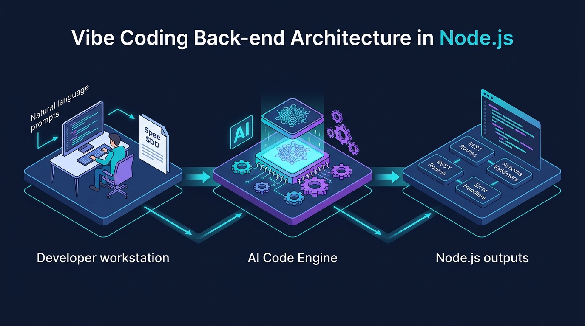

# Aula 02: Configuração de Ambiente Node.js e Arquitetura Web na Prática (Laboratório)



## 1. Objetivos de Aprendizagem

Ao concluir este laboratório presencial, você será capaz de:
- [x] **Configurar** o ambiente de desenvolvimento local com Node.js LTS, suporte nativo a arquivos `.env` (`--env-file`) e cliente de teste de APIs.
- [x] **Implementar** o roteamento básico e a leitura de *streams* de dados JSON em requisições `POST` usando JavaScript Vanilla no Node.js.
- [x] **Diagnosticar** cabeçalhos HTTP (*Headers*), códigos de status e tempos de resposta em chamadas locais.

---

## 2. Fundamentação Teórica (Markdown)

### 2.1 Anatomia do Protocolo HTTP na Arquitetura Cliente-Servidor
Toda comunicação entre um front-end (seja em **JavaScript Vanilla** ou **React**) e um back-end (**Node.js** ou **PocketBase**) fundamenta-se na troca de mensagens HTTP:
- **Request (Requisição)**: Composta pelo **Método/Verbo** (`GET`, `POST`, `PUT`, `PATCH`, `DELETE`), **URI** (`/cursos?turno=noite`), **Headers** (`Content-Type: application/json`, `Authorization: Bearer ...`) e **Body** (carga útil serializada em JSON).
- **Response (Resposta)**: Composta pelo **Status Code** (`200 OK`, `201 Created`, `400 Bad Request`, `404 Not Found`, `500 Internal Server Error`), **Headers** de resposta (incluindo políticas de CORS) e **Body** de retorno.

### 2.2 Variáveis de Ambiente Nativas no Node.js
Boas práticas de engenharia de software (12-Factor App) determinam que portas de rede, chaves secretas e URLs do **PocketBase** jamais devem ser escritas diretamente no código-fonte (*hardcoded*). A partir do Node.js 20.6+, carregamos variáveis diretamente sem pacotes externos usando a flag `--env-file=.env`.

---

## 3. Atividade Prática Guiada (Hands-on)

### Passo 1: Especificação de Parser JSON Assíncrono com Vibe Coding
Solicite ao assistente de IA a criação de uma função utilitária para ler o corpo (*stream*) de uma requisição HTTP em Node.js puro com limite de tamanho contra ataques de sobrecarga:

```text
[SPEC-PROMPT]: Escreva uma função assíncrona lerBodyJson(req) em Node.js puro (JavaScript ES6+) que colete os chunks da requisição HTTP, aplique um limite de segurança de 1MB e faça o JSON.parse, lançando um erro com statusCode 400 caso o JSON seja inválido.
```

### Passo 2: Código de Referência do Laboratório

```javascript
// src/httpParser.js — Leitura Segura de Stream JSON em Node.js
export async function lerBodyJson(req, limiteBytes = 1024 * 1024) {
  return new Promise((resolve, reject) => {
    let dados = '';
    let bytesRecebidos = 0;

    req.on('data', (chunk) => {
      bytesRecebidos += chunk.length;
      if (bytesRecebidos > limiteBytes) {
        const erro = new Error('Payload excede o limite máximo de 1MB.');
        erro.statusCode = 413;
        reject(erro);
        req.destroy();
        return;
      }
      dados += chunk.toString('utf-8');
    });

    req.on('end', () => {
      if (!dados) return resolve({});
      try {
        resolve(JSON.parse(dados));
      } catch {
        const erro = new Error('Formato JSON malformado no corpo da requisição.');
        erro.statusCode = 400;
        reject(erro);
      }
    });

    req.on('error', reject);
  });
}
```

### Passo 3: Teste de Validação no Laboratório
Teste o parser enviando um JSON válido e um JSON malformado via `curl` ou script de teste para verificar o retorno exato do código `400 Bad Request`.

---

## 4. Especificação de Ativos Visuais

### Prompt de Imagem (`DW3-U01-DIAG01`)
```text
[TIPO]: DIAG
[TEMA]: Vibe Coding Back-end Workflow in Node.js
[ESTILO]: Modern minimalist tech vector illustration, clean lines, dark mode background (#0F172A), vibrant accent colors (#06B6D4, #A855F7).
[COMPOSIÇÃO]: Professional isometric technical diagram showing a developer entering natural language specifications on the left, feeding into an AI Code Engine in the center. The AI Engine outputs structured Node.js REST routes, JavaScript schema validators, and HTTP error handlers on the right.
[TEXT RENDERING]: Crisp legible text rendering for labels: "Spec SDD", "AI Code Engine", "Node.js REST API".
[ASPECT RATIO]: 16:9
```
