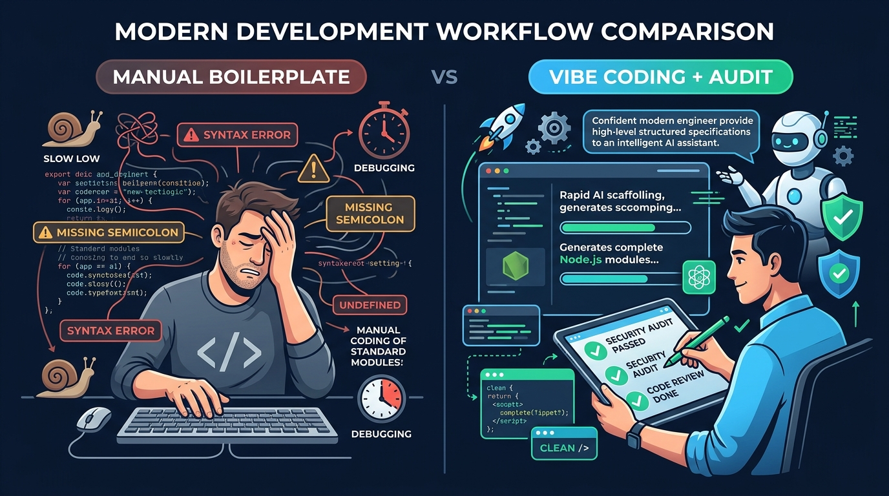

# Aula 03: Padrões de Arquitetura Back-end (MVC/Controllers) e Scaffolding com Vibe Coding



## 1. Objetivos de Aprendizagem

Ao concluir este encontro síncrono, você será capaz de:
- [x] **Estruturar** um projeto back-end Node.js separando responsabilidades entre *Routes*, *Controllers*, *Services* e *Models*.
- [x] **Elaborar** especificações de *Scaffolding* para assistentes de IA gerarem controladores padronizados sem misturar regras de negócio com manipulação de HTTP.
- [x] **Refatorar** um código monolítico em camadas modulares em JavaScript ES6+.

---

## 2. Fundamentação Teórica (Markdown)

### 2.1 O Padrão MVC e Arquitetura em Camadas para APIs REST
No desenvolvimento tradicional com renderização no servidor, o padrão **MVC (Model-View-Controller)** dividia a aplicação em Dados (*Model*), Tela HTML (*View*) e Controle (*Controller*). Em arquiteturas modernas onde a *View* é um front-end desacoplado em **React** ou **JavaScript Vanilla**, adaptamos o MVC no Node.js para três camadas essenciais:
1. **Controller (Controlador HTTP)**: Recebe `req` e `res`, extrai parâmetros, aciona o *Service* e devolve o status HTTP adequado.
2. **Service (Regra de Negócio)**: Aplica validações acadêmicas (ex.: verificar se o aluno já possui matrícula ativa) de forma independente do protocolo HTTP.
3. **Repository / Model (Persistência)**: Comunica-se com o banco de dados em memória, ORM ou **PocketBase**.

### 2.2 Scaffolding Acelerado com Vibe Coding
Quando pedimos a uma IA apenas *"crie uma API de alunos"*, ela tende a gerar um único arquivo gigante difícil de manter. No **Vibe Coding orientado a especificação**, instruímos explicitamente a arquitetura em camadas desejada.

---

## 3. Atividade Prática Guiada (Hands-on)

### Passo 1: Prompt de Scaffolding em Camadas
```text
[SPEC-PROMPT]: Gere um Service (AlunoService) e um Controller (AlunoController) em JavaScript ES6+ para Node.js seguindo o princípio da responsabilidade única. O AlunoService deve validar matrícula de 10 dígitos e nome mínimo de 3 letras, impedindo duplicidades. O AlunoController deve apenas traduzir chamadas HTTP em invocações ao Service.
```

### Passo 2: Implementação Desacoplada (`Service` + `Controller`)

```javascript
// src/services/AlunoService.js
export class AlunoService {
  constructor() {
    this.repositorio = new Map();
  }

  criar({ nome, matricula, curso = 'Técnico em Informática para Internet' }) {
    if (!nome || typeof nome !== 'string' || nome.trim().length < 3) {
      const err = new Error('O nome completo do discente deve ter pelo menos 3 caracteres.');
      err.statusCode = 422;
      throw err;
    }
    if (!/^\d{10}$/.test(String(matricula ?? ''))) {
      const err = new Error('A matrícula deve conter exatamente 10 dígitos numéricos.');
      err.statusCode = 422;
      throw err;
    }
    if (this.repositorio.has(matricula)) {
      const err = new Error('Matrícula já cadastrada no sistema acadêmico.');
      err.statusCode = 400;
      throw err;
    }

    const novoAluno = {
      id: this.repositorio.size + 1,
      nome: nome.trim(),
      matricula: String(matricula),
      curso,
      criadoEm: new Date().toISOString()
    };
    this.repositorio.set(matricula, novoAluno);
    return novoAluno;
  }

  listarTodos() {
    return Array.from(this.repositorio.values());
  }
}
```

### Passo 3: Teste de Validação
Instancie `AlunoService` em um teste isolado sem precisar subir a porta de rede HTTP, comprovando a vantagem do desacoplamento arquitetural.

---

## 4. Especificação de Ativos Visuais

### Prompt de Imagem (`DW3-U01-INFO01`)
```text
[TIPO]: INFO
[TEMA]: Manual Boilerplate vs Vibe Coding + Human Audit
[ESTILO]: Modern minimalist tech vector illustration, clean lines, dark mode background (#0F172A), vibrant accent colors (#38BDF8, #34D399).
[COMPOSIÇÃO]: Side-by-side comparison infographic. Left side showing manual repetitive boilerplate coding. Right side showing SDD specification input, AI scaffolding in Node.js, and human architectural audit.
[TEXT RENDERING]: Crisp legible text rendering for labels: "Manual Boilerplate", "Vibe Coding + Audit".
[ASPECT RATIO]: 16:9
```
