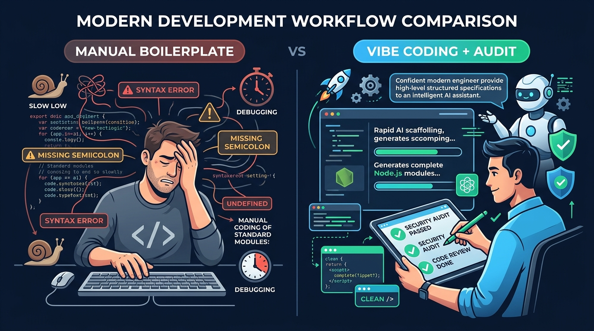

# Aula 04: Estudo Dirigido: Análise Crítica e Auditoria de Código Node.js Gerado por IA



## 1. Objetivos de Aprendizagem

Ao concluir este estudo dirigido assíncrono, você será capaz de:
- [x] **Detectar** os 5 antipadrões mais comuns gerados por modelos de IA em aplicações Node.js (bloqueio síncrono de I/O, falta de `try/catch` em funções assíncronas, pacotes alucinados, `eval()` e vazamento de *stack trace*).
- [x] **Refatorar** trechos defeituosos aplicando programação defensiva em JavaScript Vanilla.
- [x] **Aplicar** um checklist de auditoria SDD antes de aceitar sugestões de assistentes de código.

---

## 2. Fundamentação Teórica (Markdown)

### 2.1 Por que Auditar Código Gerado por IA?
No paradigma de **Vibe Coding**, a velocidade de geração aumenta exponencialmente, mas a responsabilidade técnica permanece 100% humana. Assistentes de IA treinados em repositórios públicos frequentemente reproduzem práticas obsoletas ou inseguras em Node.js:
1. **Bloqueio do Event Loop**: Uso de `fs.readFileSync` dentro de rotas HTTP, travando todas as requisições concorrentes.
2. **Alucinação de Pacotes (*Package Hallucination*)**: Sugestão de bibliotecas inexistentes ou depreciadas no `npm`.
3. **Ausência de Sanitização e Tipagem**: Confiar cegamente em `req.body` sem validar tipos primitivos (`typeof`, expressões regulares).
4. **Exposição de Stack Trace**: Retornar `err.stack` diretamente ao cliente em produção.

---

## 3. Atividade Prática Guiada (Hands-on)

### Passo 1: Cenário de Auditoria (Código Vulnerável vs. Código Auditado)
Analise o código problemático abaixo (frequentemente sugerido por prompts vagos) e compare-o com a versão refatorada:

```javascript
// ❌ CÓDIGO VULNERÁVEL (NÃO UTILIZAR EM PRODUÇÃO)
import fs from 'node:fs';

export function rotaInseguraBuscarAluno(req, res) {
  // Problema 1: Bloqueia o Event Loop inteiro lendo disco de forma síncrona
  const raw = fs.readFileSync('./alunos.json', 'utf-8');
  const alunos = JSON.parse(raw);
  // Problema 2: Uso perigoso de eval() / sem validação de entrada
  const filtro = eval(req.SearchQuery);
  res.end(JSON.stringify(alunos.filter(filtro)));
}
```

```javascript
// ✅ CÓDIGO AUDITADO E REFATORADO (PADRÃO SDD DWIII)
import fs from 'node:fs/promises';

export async function rotaSeguraBuscarAluno(termoMatricula) {
  // 1. Validação estrita de entrada com Regex (apenas dígitos)
  const matriculaLimpa = String(termoMatricula ?? '').trim();
  if (!/^\d{1,10}$/.test(matriculaLimpa)) {
    const err = new Error('Parâmetro de busca inválido. Informe apenas números.');
    err.statusCode = 400;
    throw err;
  }

  // 2. Leitura assíncrona não bloqueante com fs/promises
  const raw = await fs.readFile(new URL('./alunos.json', import.meta.url), 'utf-8');
  const alunos = JSON.parse(raw);

  // 3. Comparação segura sem execução dinâmica de código
  return alunos.filter((a) => String(a.matricula).startsWith(matriculaLimpa));
}
```

### Passo 2: Checklist de Validação do Estudo Dirigido
Sempre execute os 3 questionamentos de auditoria antes de fazer *commit*:
1. Todas as operações de I/O utilizam `async/await` ou `Promises`?
2. Todos os dados vindos do usuário passam por validação explícita de tipo e formato?
3. As dependências importadas são nativas do Node.js (`node:*`) ou estritamente homologadas no `package.json`?

---

## 4. Especificação de Ativos Visuais

### Prompt de Imagem (`DW3-U01-INFO01`)
```text
[TIPO]: INFO
[TEMA]: Auditoria de Segurança e Performance em Código Node.js Gerado por IA
[ESTILO]: Modern minimalist tech vector illustration, clean lines, dark mode background (#0F172A), vibrant accent colors (#38BDF8, #818CF8, #34D399).
[COMPOSIÇÃO]: Side-by-side infographic comparing unverified AI code vs audited Node.js production code with Event Loop and input validation shields.
[TEXT RENDERING]: Crisp legible text rendering for labels: "Manual Boilerplate", "Vibe Coding + Audit".
[ASPECT RATIO]: 16:9
```
