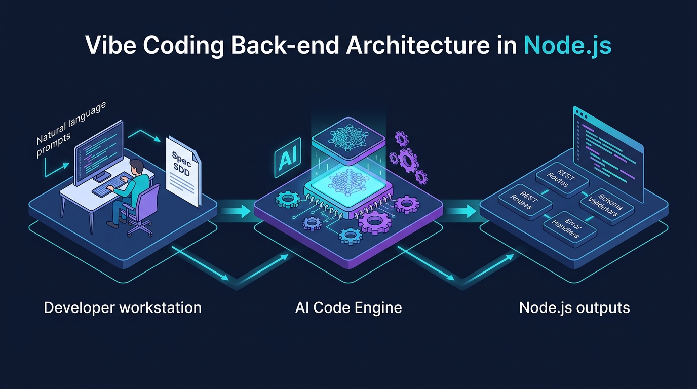

# Aula 05: Arquitetura RESTful, Verbos HTTP, Middlewares e Tratamento de Exceções



## 1. Objetivos de Aprendizagem

Ao concluir esta aula síncrona, você será capaz de:
- [x] **Mapear** operações CRUD aos verbos HTTP semânticos (`GET`, `POST`, `PUT`, `PATCH`, `DELETE`) e códigos de status (`200`, `201`, `204`, `400`, `404`, `422`, `500`).
- [x] **Construir** funções de *Middleware* (logging, CORS e autenticação) no fluxo de requisição Node.js.
- [x] **Padronizar** respostas de erro JSON com classes customizadas (`HttpError`) e tratador global de exceções.

---

## 2. Fundamentação Teórica (Markdown)

### 2.1 Semântica RESTful e Idempotência
Uma API verdadeiramente **RESTful** utiliza substantivos no plural para identificar recursos (`/alunos`, `/turmas`) e delega a ação ao verbo HTTP:

| Verbo HTTP | Rota Exemplo | Ação Semântica | Idempotente? | Status de Sucesso |
| :--- | :--- | :--- | :---: | :---: |
| `GET` | `/alunos` | Listar todos os discentes | Sim | `200 OK` |
| `GET` | `/alunos/:matricula` | Buscar discente específico | Sim | `200 OK` (ou `404`) |
| `POST` | `/alunos` | Cadastrar novo discente | Não | `201 Created` |
| `PUT` / `PATCH` | `/alunos/:matricula` | Atualizar cadastro do discente | Sim | `200 OK` |
| `DELETE` | `/alunos/:matricula` | Remover registro acadêmico | Sim | `200 OK` / `204 No Content` |

### 2.2 Tratamento Centralizado de Exceções (`HttpError`)
Em vez de espalhar blocos `res.writeHead(400)...` por dezenas de funções, criamos uma classe `HttpError extends Error` que carrega o `statusCode` e os detalhes do erro, capturando qualquer falha em um único bloco `try / catch` de alto nível no servidor.

---

## 3. Atividade Prática Guiada (Hands-on)

### Passo 1: Especificação de Tratador Global de Erros e CORS via Vibe Coding
```text
[SPEC-PROMPT]: Crie em JavaScript ES6+ uma classe HttpError(statusCode, message, details) e um wrapper de servidor HTTP em Node.js que configure cabeçalhos CORS para o front-end React e capture qualquer exceção assíncrona retornando um JSON padronizado { erro, statusCode, timestamp }.
```

### Passo 2: Implementação de `HttpError` e Middleware Handler

```javascript
// src/errors/HttpError.js
export class HttpError extends Error {
  constructor(statusCode, message, details = null) {
    super(message);
    this.name = 'HttpError';
    this.statusCode = statusCode;
    this.details = details;
  }
}

export function aplicarHeadersCors(res) {
  res.setHeader('Access-Control-Allow-Origin', '*');
  res.setHeader('Access-Control-Allow-Methods', 'GET, POST, PUT, PATCH, DELETE, OPTIONS');
  res.setHeader('Access-Control-Allow-Headers', 'Content-Type, Authorization');
}

export function responderJson(res, statusCode, payload) {
  aplicarHeadersCors(res);
  res.writeHead(statusCode, { 'Content-Type': 'application/json; charset=utf-8' });
  res.end(JSON.stringify(payload));
}
```

### Passo 3: Teste de Validação
Verifique se uma exceção `throw new HttpError(422, 'Matrícula inválida')` é automaticamente convertida em uma resposta HTTP `422 Unprocessable Entity` com cabeçalhos CORS ativos.

---

## 4. Especificação de Ativos Visuais

### Prompt de Imagem (`DW3-U01-DIAG01`)
```text
[TIPO]: DIAG
[TEMA]: Pipeline de Middlewares REST e Tratamento de Exceções em Node.js
[ESTILO]: Modern minimalist tech vector illustration, clean lines, dark mode background (#0F172A), vibrant accent colors (#38BDF8, #818CF8, #34D399).
[COMPOSIÇÃO]: Isometric flow showing HTTP Request passing through CORS Middleware, Schema Validator, Controller, and Global Error Handler returning JSON.
[TEXT RENDERING]: Crisp legible text rendering for labels: "Spec SDD", "AI Code Engine", "Node.js REST API".
[ASPECT RATIO]: 16:9
```
