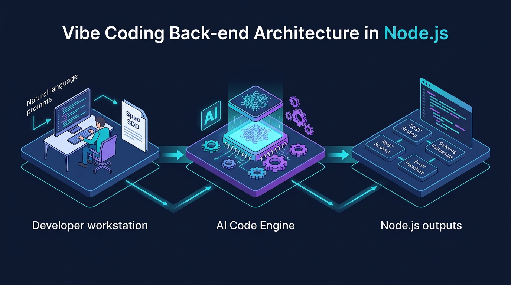

# Aula 06: Resolução de Exercícios Práticos Virtuais de Construção de APIs REST em Node.js



## 1. Objetivos de Aprendizagem

Ao concluir esta atividade prática de consolidação da Unidade I, você será capaz de:
- [x] **Implementar** a API completa de Gestão de Alunos da disciplina DWIII (`GET`, `POST`, `DELETE`) em Node.js.
- [x] **Integrar** validação de schemas, códigos HTTP (`200`, `201`, `400`, `404`, `422`) e respostas padronizadas em JSON.
- [x] **Validar** todos os cenários de sucesso e de erro por meio do script executável em `src/code-samples/u1-node-api/server.js`.

---

## 2. Fundamentação Teórica (Markdown)

### 2.1 Consolidação da Arquitetura Back-end na Unidade I
Ao longo das 5 aulas anteriores, evoluímos do entendimento do runtime **Node.js** e do **JavaScript Vanilla (ES6+)** para a construção de serviços desacoplados com tratamento de exceções HTTP e auditoria de código gerado por IA.

Nesta atividade prática, consolidamos a **API de Gestão de Alunos (DWIII)**, que servirá de base para a persistência relacional e BaaS (**PocketBase**) na Unidade II e para o consumo pelo front-end **React** na Unidade III.

---

## 3. Atividade Prática Guiada (Hands-on)

### Passo 1: Especificação Completa da API de Alunos (Vibe Coding SDD)
```text
[SPEC-PROMPT]: Implemente um módulo completo em Node.js (src/code-samples/u1-node-api/server.js) contendo o repositório em memória, validador de AlunoSchema (nome >= 3 caracteres, matrícula com 10 dígitos numéricos e curso padrão "Técnico em Informática para Internet"), funções CRUD (criarAluno, listarAlunos, buscarAlunoPorMatricula, removerAluno) e um servidor HTTP RESTful com suporte a CORS e tratamento de exceções HTTP 400, 404 e 422.
```

### Passo 2: Implementação Completa da API (`src/code-samples/u1-node-api/server.js`)

```javascript
// Exemplo consolidado da Unidade I (disponível em src/code-samples/u1-node-api/server.js)
export class ApiAlunosNode {
  constructor() {
    this.dbAlunos = new Map();
  }

  validarAluno(payload) {
    if (!payload || typeof payload.nome !== 'string' || payload.nome.trim().length < 3) {
      const err = new Error('Nome do discente deve possuir no mínimo 3 caracteres.');
      err.statusCode = 422;
      throw err;
    }
    if (!/^\d{10}$/.test(String(payload.matricula ?? ''))) {
      const err = new Error('Matrícula inválida: informe exatamente 10 dígitos numéricos.');
      err.statusCode = 422;
      throw err;
    }
    return {
      id: this.dbAlunos.size + 1,
      nome: payload.nome.trim(),
      matricula: String(payload.matricula),
      curso: payload.curso || 'Técnico em Informática para Internet'
    };
  }

  criarAluno(payload) {
    const aluno = this.validarAluno(payload);
    if (this.dbAlunos.has(aluno.matricula)) {
      const err = new Error('Matrícula já cadastrada no sistema acadêmico.');
      err.statusCode = 400;
      throw err;
    }
    this.dbAlunos.set(aluno.matricula, aluno);
    return { statusCode: 201, body: { mensagem: 'Aluno cadastrado com sucesso', dados: aluno } };
  }
}
```

### Passo 3: Exercícios de Validação Obrigatórios (Entrega no Moodle)
1. **Cenário 1 (Sucesso `201`)**: Cadastre um discente com matrícula `"2026100123"` e verifique o retorno JSON.
2. **Cenário 2 (Duplicidade `400`)**: Tente recadastrar a mesma matrícula `"2026100123"` e confirme a exceção HTTP `400`.
3. **Cenário 3 (Validação `422`)**: Envie uma matrícula com letras (`"2026ABC"`), confirmando o bloqueio pelo validador de schema.

---

## 4. Especificação de Ativos Visuais

### Prompt de Imagem (`DW3-U01-DIAG01`)
```text
[TIPO]: DIAG
[TEMA]: Arquitetura Completa da API REST de Gestão de Alunos em Node.js
[ESTILO]: Modern minimalist tech vector illustration, clean lines, dark mode background (#0F172A), vibrant accent colors (#38BDF8, #818CF8, #34D399).
[COMPOSIÇÃO]: Technical diagram showing HTTP Client requests (POST/GET/DELETE /alunos) processed by Node.js Router, Schema Validator, and In-Memory Store.
[TEXT RENDERING]: Crisp legible text rendering for labels: "POST /alunos", "201 Created", "400 Bad Request".
[ASPECT RATIO]: 16:9
```
