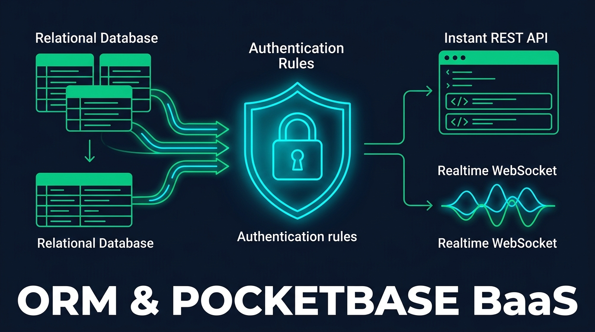

# Aula 01: Conceitos Fundamentais de ORM em Node.js e Abstração de Entidades



## 1. Objetivos de Aprendizagem

Ao concluir esta aula assíncrona, você será capaz de:
- [x] **Explicar** o conceito de *Object-Relational Impedance Mismatch* (Impedância Objeto-Relacional) entre objetos JavaScript em memória e bancos relacionais SQL (SQLite/PostgreSQL).
- [x] **Diferenciar** drivers SQL puros (`node:sqlite`), *Query Builders* e frameworks **ORM** (Prisma / Drizzle / Sequelize).
- [x] **Modelar** entidades do domínio escolar como classes e schemas tipados em Node.js.

---

## 2. Fundamentação Teórica (Markdown)

### 2.1 Da Memória Volátil à Persistência Relacional
Na Unidade I, armazenamos os discentes em estruturas `Map` na memória RAM do processo Node.js. Caso o servidor reinicie, todos os dados são perdidos. Para garantir durabilidade (**ACID**: Atomicidade, Consistência, Isolamento e Durabilidade), utilizamos Sistemas Gerenciadores de Banco de Dados Relacionais (SGBDs), como **SQLite** (embutido no próprio **PocketBase** e no Node.js moderno) e **PostgreSQL**.

### 2.2 O Papel do ORM (Object-Relational Mapping)
Enquanto o código em **Node.js / JavaScript** manipula grafos de objetos dinâmicos, propriedades aninhadas e arrays, o banco relacional opera sobre tuplas (linhas), colunas tipadas e chaves estrangeiras. O **ORM** atua como uma camada tradutora que:
1. Converte operações de métodos JavaScript (`AlunoModel.create()`, `AlunoModel.findMany()`) em instruções SQL parametrizadas seguras contra *SQL Injection*.
2. Hidrata as linhas retornadas pelo banco em objetos JavaScript prontos para serialização JSON.

---

## 3. Atividade Prática Guiada (Hands-on)

### Passo 1: Prompt de Especificação de Entidade ORM em Node.js
```text
[SPEC-PROMPT]: Gere uma classe de repositório ORM leve em JavaScript ES6+ que abstraia uma tabela SQL "alunos" (id, nome, matricula, curso, ativo, criado_em), gerando queries SQL parametrizadas seguras (Prepared Statements) e hidratando os registros para objetos camelCase.
```

### Passo 2: Implementação de Abstração de Entidade Relacional

```javascript
// src/orm/AlunoModel.js — Abstração Objeto-Relacional Parametrizada
export class AlunoEntity {
  constructor(row) {
    this.id = row.id;
    this.nome = row.nome;
    this.matricula = row.matricula;
    this.curso = row.curso;
    this.ativo = Boolean(row.ativo);
    this.criadoEm = row.criado_em;
  }

  static toSqlInsert(dados) {
    return {
      sql: `INSERT INTO alunos (nome, matricula, curso, ativo, criado_em) VALUES (?, ?, ?, ?, ?)`,
      params: [
        dados.nome.trim(),
        String(dados.matricula),
        dados.curso || 'Técnico em Informática para Internet',
        dados.ativo !== false ? 1 : 0,
        new Date().toISOString()
      ]
    };
  }
}
```

### Passo 3: Teste de Validação
Verifique como `AlunoEntity.toSqlInsert()` separa a string SQL (`?`) do vetor de parâmetros (`params`), eliminando qualquer risco de concatenação maliciosa (*SQL Injection*).

---

## 4. Especificação de Ativos Visuais

### Prompt de Imagem (`DW3-U02-ART01`)
```text
[TIPO]: ART
[TEMA]: Persistência Relacional, ORM e PocketBase BaaS
[ESTILO]: Modern minimalist tech vector illustration, clean lines, dark mode background (#0F172A), vibrant accent colors (#10B981, #0284C7).
[COMPOSIÇÃO]: Conceptual cover art for Unidade II showing relational database tables seamlessly transforming into instant REST and Realtime API streams with built-in authentication shield.
[TEXT RENDERING]: Crisp legible text rendering for labels: "ORM & POCKETBASE BaaS".
[ASPECT RATIO]: 21:9
```
