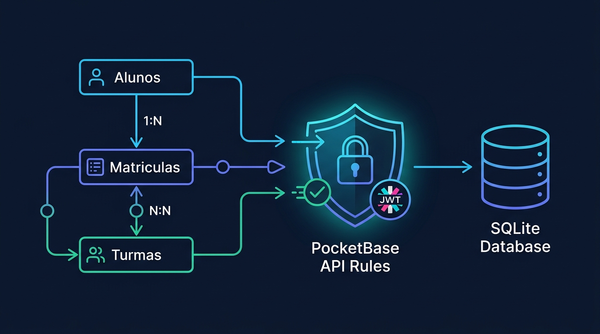

# Aula 02: Mapeamento de Atributos, Chaves e Relacionamentos no ORM



## 1. Objetivos de Aprendizagem

Ao concluir esta aula síncrona, você será capaz de:
- [x] **Especificar** restrições de coluna (`PRIMARY KEY`, `FOREIGN KEY`, `UNIQUE`, `NOT NULL`, `DEFAULT`) em schemas de banco de dados.
- [x] **Implementar** associações Um-para-Muitos (`1:N`) e Muitos-para-Muitos (`N:N`) com tabela associativa (`matriculas_turmas`).
- [x] **Configurar** políticas de integridade referencial (`ON DELETE CASCADE` vs. `RESTRICT`).

---

## 2. Fundamentação Teórica (Markdown)

### 2.1 Cardinalidade e Integridade Referencial no Domínio Acadêmico
Em um sistema acadêmico real do IFCE, as entidades não existem isoladas:
- **Relacionamento `1:N` (Um para Muitos)**: Um **Curso** (`cursos`) possui várias **Turmas** (`turmas`), mas cada turma pertence a um único curso principal via chave estrangeira `curso_id`.
- **Relacionamento `N:N` (Muitos para Muitos)**: Um **Aluno** pode cursar várias **Disciplinas/Turmas**, e uma **Turma** contém vários **Alunos**. Essa relação é resolvida pela entidade associativa **Matrícula** (`matriculas`), que armazena também os atributos próprios do vínculo (`nota_ad`, `nota_ap`, `frequencia`).

---

## 3. Atividade Prática Guiada (Hands-on)

### Passo 1: Prompt de Especificação de Relacionamentos SQL/ORM
```text
[SPEC-PROMPT]: Gere o schema DDL relacional (compatível com SQLite / PocketBase) e a representação em objetos JavaScript para as tabelas cursos, alunos e matriculas, garantindo chaves estrangeiras e restrição UNIQUE composta para impedir que o mesmo aluno se matricule duas vezes na mesma disciplina.
```

### Passo 2: Schema Relacional Declarativo

```javascript
// src/orm/schemaRelacional.js
export const DDL_SISTEMA_ACADEMICO = `
CREATE TABLE IF NOT EXISTS cursos (
  id TEXT PRIMARY KEY,
  codigo TEXT NOT NULL UNIQUE,
  nome TEXT NOT NULL
);

CREATE TABLE IF NOT EXISTS alunos (
  id TEXT PRIMARY KEY,
  nome TEXT NOT NULL,
  matricula TEXT NOT NULL UNIQUE,
  curso_id TEXT NOT NULL,
  FOREIGN KEY (curso_id) REFERENCES cursos(id) ON DELETE RESTRICT
);

CREATE TABLE IF NOT EXISTS matriculas_disciplinas (
  id TEXT PRIMARY KEY,
  aluno_id TEXT NOT NULL,
  disciplina_codigo TEXT NOT NULL,
  nota_ad REAL DEFAULT 0,
  nota_ap REAL DEFAULT 0,
  frequencia REAL DEFAULT 100,
  UNIQUE(aluno_id, disciplina_codigo),
  FOREIGN KEY (aluno_id) REFERENCES alunos(id) ON DELETE CASCADE
);
`;
```

### Passo 3: Teste de Validação
Analise a cláusula `UNIQUE(aluno_id, disciplina_codigo)` e explique como o próprio motor do banco de dados impede matrículas duplicadas mesmo sob requisições concorrentes.

---

## 4. Especificação de Ativos Visuais

### Prompt de Imagem (`DW3-U02-DIAG01`)
```text
[TIPO]: DIAG
[TEMA]: Mapeamento Relacional de Entidades (1:N e N:N) e Integridade Referencial
[ESTILO]: Modern minimalist tech vector illustration, clean lines, dark mode background (#0F172A), vibrant accent colors (#38BDF8, #818CF8, #34D399).
[COMPOSIÇÃO]: Technical vector architecture diagram illustrating Relational Entity Mapping (1:N and N:N between Alunos, Matriculas, Turmas) and PocketBase API Rules security filter shield validating JWT Auth tokens before querying SQLite storage.
[TEXT RENDERING]: Crisp legible text rendering for labels: "Alunos", "Matriculas (N:N)", "Turmas", "SQLite".
[ASPECT RATIO]: 16:9
```
