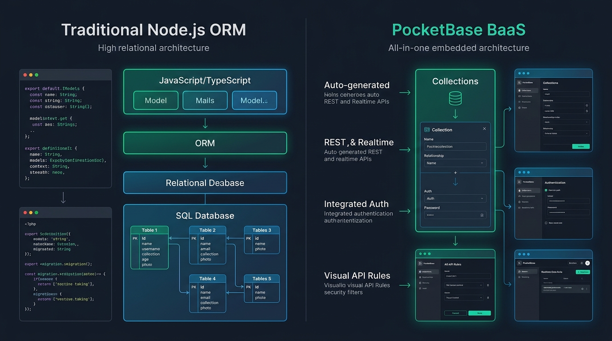

# Aula 03: Modelagem e Geração Automática de Migrações (Migrations)



## 1. Objetivos de Aprendizagem

Ao concluir esta aula assíncrona, você será capaz de:
- [x] **Explicar** por que alterações manuais em bancos de produção são proibidas em equipes profissionais de engenharia de software.
- [x] **Escrever** scripts de migração reversíveis (`up` para aplicar mudanças e `down` para reverter/*rollback*) em JavaScript/Node.js.
- [x] **Implementar** scripts de *Seed* para popular automaticamente o ambiente de desenvolvimento.

---

## 2. Fundamentação Teórica (Markdown)

### 2.1 O que são Database Migrations?
Assim como o Git controla o histórico de alterações do código-fonte JavaScript, as **Migrations (Migrações)** controlam o histórico evolutivo do esquema do banco de dados. Tanto em ORMs tradicionais do ecossistema Node.js (Prisma Migrate, Knex, Drizzle Kit) quanto internamente no **PocketBase** (`pb_migrations`), cada alteração estrutural é gravada em um arquivo datado contendo duas funções:
- **`up(db)`**: Aplica a evolução (ex.: cria a coleção/tabela `projetos` ou adiciona a coluna `github_url`).
- **`down(db)`**: Desfaz a alteração com segurança caso um deploy apresente falhas.

---

## 3. Atividade Prática Guiada (Hands-on)

### Passo 1: Especificação de Migration Compatível com Node.js / PocketBase
```text
[SPEC-PROMPT]: Gere uma estrutura de migração em JavaScript (padrão up/down) que adicione o campo "github_repo" e "nota_final" na coleção/tabela de alunos, acompanhada de uma função de seed que insira 3 discentes de exemplo do IFCE Campus Baturité.
```

### Passo 2: Implementação de Migration e Seed

```javascript
// src/orm/migrations/20261102_add_github_repo.js
export const migrationAddGithubRepo = {
  id: '20261102_01_add_github_repo',
  up(schemaState) {
    schemaState.columns.push(
      { name: 'github_repo', type: 'TEXT', required: false },
      { name: 'nota_final', type: 'REAL', default: 0.0 }
    );
    return schemaState;
  },
  down(schemaState) {
    schemaState.columns = schemaState.columns.filter(
      (col) => col.name !== 'github_repo' && col.name !== 'nota_final'
    );
    return schemaState;
  }
};

export const seedAlunosIniciais = [
  { nome: 'Ana Clara Martins', matricula: '2026100101', curso: 'Técnico em Informática para Internet' },
  { nome: 'Carlos Eduardo Silva', matricula: '2026100102', curso: 'Técnico em Informática para Internet' },
  { nome: 'Beatriz Oliveira Lima', matricula: '2026100103', curso: 'Técnico em Informática para Internet' }
];
```

### Passo 3: Teste de Validação
Execute a função `up()` seguida de `down()` sobre um objeto de estado inicial para comprovar a idempotência da reversão do esquema.

---

## 4. Especificação de Ativos Visuais

### Prompt de Imagem (`DW3-U02-INFO01`)
```text
[TIPO]: INFO
[TEMA]: ORM vs PocketBase BaaS Low-Code Architecture
[ESTILO]: Modern minimalist tech vector illustration, clean lines, dark mode background (#0F172A), vibrant accent colors (#10B981, #0284C7).
[COMPOSIÇÃO]: Side-by-side comparison infographic. Left side labeled "Traditional Node.js ORM" showing JavaScript Models mapping to SQL Tables via Migration Scripts. Right side labeled "PocketBase BaaS" showing direct Auto-generated REST & Realtime APIs from SQLite Collections with built-in Auth.
[TEXT RENDERING]: Crisp legible text rendering for labels: "Traditional Node.js ORM", "PocketBase BaaS".
[ASPECT RATIO]: 16:9
```
