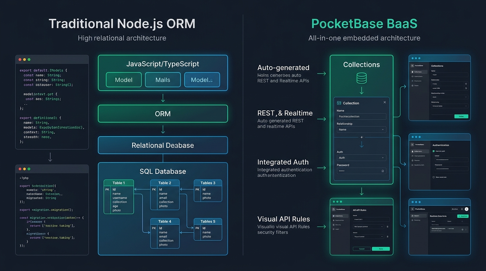

# Aula 04: Automação de Scripts de Banco de Dados e Introdução ao BaaS com PocketBase



## 1. Objetivos de Aprendizagem

Ao concluir esta aula assíncrona, você será capaz de:
- [x] **Comparar** a construção tradicional de back-end + ORM com a abordagem **Backend-as-a-Service (BaaS)** utilizando **PocketBase**.
- [x] **Configurar** coleções (*Base*, *Auth* e *View*) no painel administrativo do PocketBase (`http://127.0.0.1:8090/_/`).
- [x] **Consumir** os endpoints RESTful gerados automaticamente pelo PocketBase usando **JavaScript Vanilla / Node.js**.

---

## 2. Fundamentação Teórica (Markdown)

### 2.1 Por que PocketBase revolucionou o Desenvolvimento Low-Code / BaaS?
O **PocketBase** é um Backend-as-a-Service *open-source* distribuído em um único executável leve que entrega instantaneamente:
1. **Banco de Dados SQLite Embutido (modo WAL)**: Altíssima performance de leitura e escrita sem necessidade de configurar servidores pesados de banco de dados.
2. **REST API Automática**: Ao criar uma coleção `alunos`, o PocketBase disponibiliza imediatamente endpoints prontos para paginação, ordenação, filtragem e CRUD (`/api/collections/alunos/records`).
3. **Autenticação Nativa (JWT + OAuth2)**: Coleções do tipo `Auth` gerenciam cadastro de usuários, hash de senhas (`bcrypt`) e emissão de tokens JWT sem escrever boilerplate.
4. **Assinaturas em Tempo Real (*Realtime via Server-Sent Events*)**: O front-end em **React** ou **JS Vanilla** pode escutar mudanças na tabela instantaneamente.

---

## 3. Atividade Prática Guiada (Hands-on)

### Passo 1: Prompt de Especificação de Cliente PocketBase em JS/Node.js
```text
[SPEC-PROMPT]: Crie um cliente JavaScript modular (PocketBaseClient) que se comunique com a REST API padrão do PocketBase (/api/collections/alunos/records), suportando listagem paginada com filtros, criação de registro e simulação local para testes automatizados offline.
```

### Passo 2: Implementação de Integração com PocketBase

```javascript
// Exemplo de consumo da API REST do PocketBase em JavaScript Vanilla / Node.js
export class PocketBaseAlunosService {
  constructor(baseUrl = 'http://127.0.0.1:8090') {
    this.baseUrl = baseUrl;
  }

   montarUrlColecao(colecao = 'alunos', params = {}) {
    const url = new URL(`/api/collections/${colecao}/records`, this.baseUrl);
    for (const [chave, valor] of Object.entries(params)) {
      if (valor !== undefined && valor !== null) {
        url.searchParams.set(chave, String(valor));
      }
    }
    return url.toString();
  }

  async listarAlunos({ page = 1, perPage = 20, filter = '' } = {}, fetchFn = fetch) {
    const endpoint = this.montarUrlColecao('alunos', { page, perPage, filter, sort: '-created' });
    const resposta = await fetchFn(endpoint, {
      headers: { 'Content-Type': 'application/json' }
    });
    if (!resposta.ok) {
      throw new Error(`Falha ao consultar PocketBase: HTTP ${resposta.status}`);
    }
    return resposta.json();
  }
}
```

### Passo 3: Teste de Validação
Inspecione a URL gerada por `montarUrlColecao('alunos', { page: 1, perPage: 10, filter: 'ativo=true' })` e confirme que segue exatamente o contrato `/api/collections/alunos/records?page=1&perPage=10&filter=ativo%3Dtrue&sort=-created`.

---

## 4. Especificação de Ativos Visuais

### Prompt de Imagem (`DW3-U02-INFO01`)
```text
[TIPO]: INFO
[TEMA]: Comparativo Arquitetural Node.js ORM vs PocketBase BaaS
[ESTILO]: Modern minimalist tech vector illustration, clean lines, dark mode background (#0F172A), vibrant accent colors (#10B981, #0284C7).
[COMPOSIÇÃO]: Side-by-side infographic comparing traditional Node.js ORM stack with PocketBase single-binary BaaS architecture.
[TEXT RENDERING]: Crisp legible text rendering for labels: "Traditional Node.js ORM", "PocketBase BaaS".
[ASPECT RATIO]: 16:9
```
