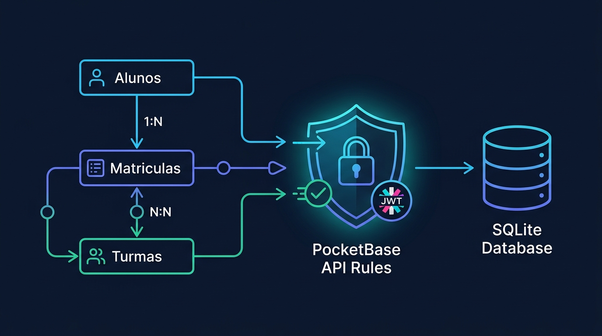

# Aula 05: Laboratório Prático: Integração Back-end Node.js + ORM/PocketBase (1ª Avaliação Prática)



## 1. Objetivos de Aprendizagem

Ao concluir este laboratório presencial avaliativo (AP1), você será capaz de:
- [x] **Integrar** um serviço Node.js a uma coleção persistente do **PocketBase**.
- [x] **Implementar** a regra oficial de cálculo da Média Semestral Parcial ($X_S = \frac{2 \cdot AD + 3 \cdot AP}{5}$) do ROD/IFCE antes de gravar o boletim do aluno no banco.
- [x] **Demonstrar** operações completas de criação, consulta filtrada e atualização de notas com persistência real.

---

## 2. Fundamentação Teórica (Markdown)

### 2.1 Arquitetura Híbrida: Quando usar PocketBase direto vs. Node.js + PocketBase?
Em aplicações reais:
- **Operações CRUD diretas** (listar cursos, exibir perfil do aluno) podem ser consumidas diretamente do **PocketBase** pelo front-end **React**, protegidas pelas *API Rules*.
- **Regras de negócio críticas ou integrações externas** (cálculo oficial de médias segundo o ROD do IFCE, emissão de certificados assinados, disparo de e-mails ou geração de relatórios) são processadas pelo servidor **Node.js**, que atua como orquestrador confiável e persiste o resultado no PocketBase.

---

## 3. Atividade Prática Guiada (Hands-on — 1ª Avaliação Prática)

### Passo 1: Especificação do Serviço Avaliativo (ROD/IFCE + PocketBase)
```text
[SPEC-PROMPT]: Implemente em JavaScript ES6+ a função calcularMediaSemestralIFCE(notaAD, notaAP, frequenciaPercentual) seguindo a fórmula oficial Xs = (2*AD + 3*AP)/5 do ROD/IFCE, determinando a situação ("APROVADO_POR_MEDIA", "EXAME_FINAL_EFP" ou "REPROVADO") e preparando o registro para persistência na coleção "matriculas" do PocketBase.
```

### Passo 2: Implementação da Regra de Negócio Acadêmica e Persistência

```javascript
// src/code-samples/u2-pocketbase-orm/pocketbase-client.js (Trecho da AP1)
export function calcularMediaSemestralIFCE(notaAD, notaAP, frequencia) {
  const ad = Number(notaAD);
  const ap = Number(notaAP);
  const freq = Number(frequencia);

  if (Number.isNaN(ad) || ad < 0 || ad > 10 || Number.isNaN(ap) || ap < 0 || ap > 10) {
    throw new Error('As notas AD e AP devem estar no intervalo de 0.0 a 10.0.');
  }
  if (Number.isNaN(freq) || freq < 0 || freq > 100) {
    throw new Error('O percentual de frequência deve estar entre 0 e 100.');
  }

  const mediaXs = Number(((2 * ad + 3 * ap) / 5).toFixed(2));
  let situacao = 'REPROVADO';

  if (freq < 75) {
    situacao = 'REPROVADO_POR_FALTA';
  } else if (mediaXs >= 6.0) {
    situacao = 'APROVADO_POR_MEDIA';
  } else if (mediaXs >= 3.0) {
    situacao = 'EXAME_FINAL_EFP';
  }

  return { notaAD: ad, notaAP: ap, frequencia: freq, mediaXs, situacao };
}
```

### Passo 3: Rubrica de Validação Presencial (AP1)
1. Testar aluno com `AD = 8.0`, `AP = 7.0`, `Frequência = 85%` → Deve resultar em `mediaXs = 7.4` e `APROVADO_POR_MEDIA`.
2. Testar aluno com `AD = 5.0`, `AP = 4.0`, `Frequência = 80%` → Deve resultar em `mediaXs = 4.4` e `EXAME_FINAL_EFP`.
3. Testar aluno com `AD = 9.0`, `AP = 9.0`, `Frequência = 70%` → Deve resultar em `REPROVADO_POR_FALTA`.

---

## 4. Especificação de Ativos Visuais

### Prompt de Imagem (`DW3-U02-DIAG01`)
```text
[TIPO]: DIAG
[TEMA]: Integração Node.js + PocketBase + Banco SQLite no Laboratório Avaliativo
[ESTILO]: Modern minimalist tech vector illustration, clean lines, dark mode background (#0F172A), vibrant accent colors (#38BDF8, #818CF8, #34D399).
[COMPOSIÇÃO]: Architecture flow showing Node.js Business Logic calculating IFCE Academic Grades and persisting records into PocketBase SQLite Collections.
[TEXT RENDERING]: Crisp legible text rendering for labels: "Node.js API", "PocketBase", "SQLite".
[ASPECT RATIO]: 16:9
```
