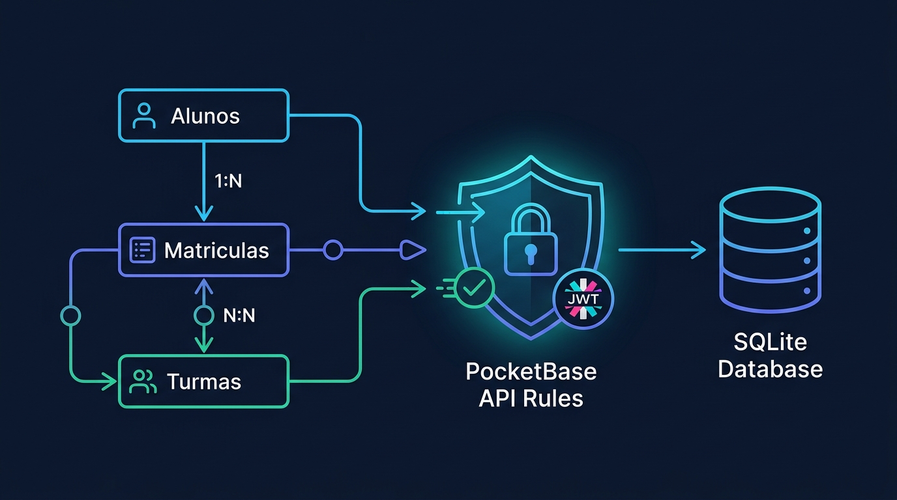

# Aula 06: Consultas Avançadas, Joins/Expand e Performance no ORM e PocketBase auxiliados por IA



## 1. Objetivos de Aprendizagem

Ao concluir esta aula síncrona, você será capaz de:
- [x] **Identificar** e resolver a anomalia de performance conhecida como **Problema da Query `N+1`**.
- [x] **Construir** consultas relacionais eficientes utilizando `JOIN` no ORM e o operador `expand` no **PocketBase**.
- [x] **Otimizar** buscas utilizando índices (`CREATE INDEX`) e paginação baseada em limites (`page` / `perPage`).

---

## 2. Fundamentação Teórica (Markdown)

### 2.1 O Problema Clássico de Performance `N+1`
Imagine listar 50 matrículas e, dentro de um laço `for`, disparar uma nova consulta ao banco para descobrir o nome do aluno e o nome do curso de cada matrícula:
- `1` consulta principal para buscar as 50 matrículas;
- `+ 50` consultas individuais para buscar cada aluno = **51 viagens de rede ao banco de dados!**

### 2.2 Solução no ORM (`JOIN` / `include`) e no PocketBase (`expand`)
No **PocketBase**, eliminamos o problema `N+1` passando o parâmetro `expand=aluno_id,curso_id` em uma única requisição HTTP. O PocketBase resolve os relacionamentos internamente no SQLite e já aninha os objetos expandidos dentro da propriedade `record.expand`.

---

## 3. Atividade Prática Guiada (Hands-on)

### Passo 1: Prompt de Otimização de Query com Vibe Coding
```text
[SPEC-PROMPT]: Escreva uma função em JavaScript que construa parâmetros de consulta avançados para o PocketBase, combinando filtro composto (notas maiores ou iguais a 6 e frequência >= 75), ordenação decrescente por média e expansão automática das relações aluno_id e turma_id (expand) para evitar o problema N+1.
```

### Passo 2: Construtor de Consultas Otimizadas no PocketBase

```javascript
// src/orm/queryBuilderPocketBase.js
export function construirQueryAprovados({ cursoCodigo = 'INFO-INT', pagina = 1 } = {}) {
  const filtro = `mediaXs >= 6.0 && frequencia >= 75 && turma_id.curso_codigo = "${cursoCodigo}"`;
  return {
    page: pagina,
    perPage: 25,
    filter: filtro,
    sort: '-mediaXs,created',
    expand: 'aluno_id,turma_id' // Evita o problema N+1 trazendo Aluno e Turma na mesma query!
  };
}
```

### Passo 3: Teste de Validação
Verifique que a consulta retornada inclui `expand: 'aluno_id,turma_id'`, reduzindo 26 requisições sequenciais para apenas **1 única requisição HTTP**.

---

## 4. Especificação de Ativos Visuais

### Prompt de Imagem (`DW3-U02-DIAG01`)
```text
[TIPO]: DIAG
[TEMA]: Otimização de Consultas Relacionais e Eliminação do Problema N+1 com Expand no PocketBase
[ESTILO]: Modern minimalist tech vector illustration, clean lines, dark mode background (#0F172A), vibrant accent colors (#38BDF8, #818CF8, #34D399).
[COMPOSIÇÃO]: Technical diagram showing single relational query with expand=aluno_id,turma_id fetching joined records from SQLite in one roundtrip.
[TEXT RENDERING]: Crisp legible text rendering for labels: "Alunos", "Matriculas (N:N)", "Turmas", "SQLite".
[ASPECT RATIO]: 16:9
```
