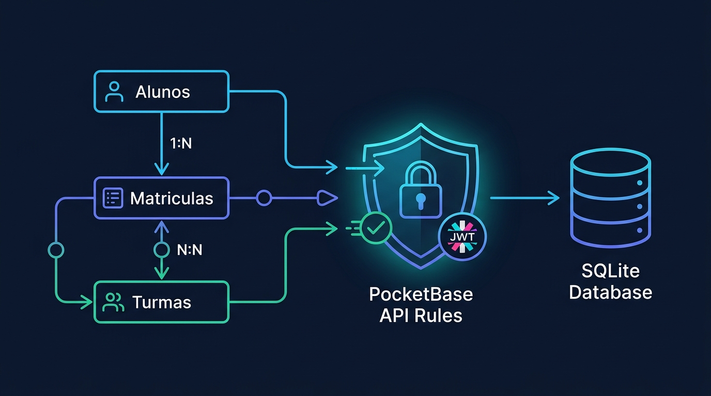

# Aula 07: Atividade de Fixação: Mapeamento de Tabelas Complexas e API Rules no PocketBase



## 1. Objetivos de Aprendizagem

Ao concluir esta atividade assíncrona de fechamento da Unidade II, você será capaz de:
- [x] **Configurar** as 5 regras de acesso (*API Rules*: `listRule`, `viewRule`, `createRule`, `updateRule`, `deleteRule`) em coleções do **PocketBase**.
- [x] **Escrever** expressões de segurança utilizando o contexto `@request.auth.id` e `@request.auth.role`.
- [x] **Auditar** regras de acesso com auxílio de IA para impedir que um estudante altere notas de outros estudantes.

---

## 2. Fundamentação Teórica (Markdown)

### 2.1 Segurança Declarativa no Banco: As *API Rules* do PocketBase
Por padrão, toda coleção criada no **PocketBase** vem bloqueada (`Admin Only` = `null`), impedindo acessos públicos acidentais. Para liberar o acesso seguro diretamente para o front-end **React**, configuramos expressões booleanas avaliadas a cada requisição:

| Operação | Regra no PocketBase (`matriculas`) | Significado Pedagógico e de Segurança |
| :--- | :--- | :--- |
| **List / View** | `@request.auth.id != "" && (aluno_id = @request.auth.id \|\| @request.auth.role = "docente")` | O aluno logado vê apenas seu próprio boletim; professores veem todos. |
| **Create / Update** | `@request.auth.role = "docente" \|\| @request.auth.role = "coordenador"` | Apenas docentes ou coordenadores autenticados podem lançar ou alterar notas. |
| **Delete** | `@request.auth.role = "coordenador"` | Somente a coordenação pode excluir registros de matrícula. |

---

## 3. Atividade Prática Guiada (Hands-on)

### Passo 1: Prompt de Especificação de Regras de Segurança no PocketBase
```text
[SPEC-PROMPT]: Gere um avaliador em JavaScript que simule a validação das API Rules do PocketBase para a coleção "matriculas", verificando o objeto de contexto auth ({ id, role }) e o registro alvo ({ aluno_id }) para as operações view, update e delete.
```

### Passo 2: Simulador de Avaliação de API Rules em JavaScript

```javascript
// src/code-samples/u2-pocketbase-orm/pocketbase-client.js (Validador de API Rules)
export function avaliarRegraAcessoPocketBase(operacao, authUser, registroMatricula) {
  if (!authUser || !authUser.id) return false; // Não autenticado

  switch (operacao) {
    case 'view':
    case 'list':
      return authUser.role === 'docente' || authUser.role === 'coordenador' || registroMatricula.aluno_id === authUser.id;
    case 'create':
    case 'update':
      return authUser.role === 'docente' || authUser.role === 'coordenador';
    case 'delete':
      return authUser.role === 'coordenador';
    default:
      return false;
  }
}
```

### Passo 3: Exercício de Fixação
Teste a função `avaliarRegraAcessoPocketBase` passando um usuário com `role: 'discente'` tentando executar `'update'` no próprio boletim e confirme que o retorno é `false` (`403 Forbidden`).

---

## 4. Especificação de Ativos Visuais

### Prompt de Imagem (`DW3-U02-DIAG01`)
```text
[TIPO]: DIAG
[TEMA]: Controle de Acesso Row-Level Security com API Rules no PocketBase
[ESTILO]: Modern minimalist tech vector illustration, clean lines, dark mode background (#0F172A), vibrant accent colors (#38BDF8, #818CF8, #34D399).
[COMPOSIÇÃO]: Security shield filter inspecting @request.auth.id and role before permitting access to SQLite collections.
[TEXT RENDERING]: Crisp legible text rendering for labels: "API Rules", "JWT Auth", "SQLite".
[ASPECT RATIO]: 16:9
```
