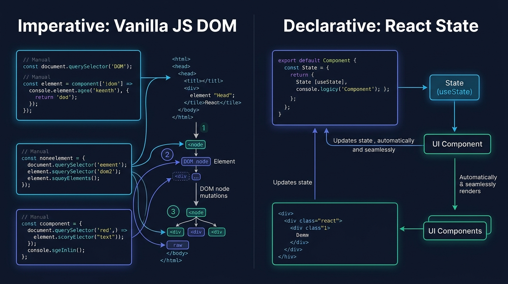

# Aula 01: Do JavaScript Vanilla ao React: Componentes Visuais, Reatividade e Ciclo de Vida


## 1. Objetivos de Aprendizagem

Ao concluir esta aula assíncrona, você será capaz de:
- [x] **Contrastar** a manipulação manual de nós do DOM em **JavaScript Vanilla** (`document.querySelector`, `appendChild`) com o modelo declarativo de **Virtual DOM** do **React**.
- [x] **Decompor** uma tela do sistema acadêmico em componentes funcionais desacoplados (`<HeaderIFCE />`, `<CardAluno />`, `<BoletimBadge />`).
- [x] **Transmitir** dados de componentes pais para filhos utilizando propriedades imutáveis (`props`).

---

## 2. Fundamentação Teórica (Markdown)

### 2.1 Paradigma Imperativo (JS Vanilla DOM) vs. Declarativo (React)
Em **JavaScript Vanilla**, quando um estado muda (por exemplo, um novo discente é cadastrado), o programador precisa descrever passo a passo *como* localizar o elemento HTML (`document.getElementById('lista-alunos')`), criar uma nova tag `<li>`, atribuir classes CSS e anexá-la à árvore DOM. Em sistemas complexos, sincronizar dezenas de elementos visuais manualmente gera bugs de inconsistência de estado.

O **React** adota a programação **declarativa**: definimos a interface como uma função pura do estado:
$$\text{UI} = f(\text{state}, \text{props})$$
Sempre que o estado muda, o React recalcula a árvore de componentes na memória e atualiza apenas os nós exatos do DOM que sofreram alteração.



---

## 3. Atividade Prática Guiada (Hands-on)

### Passo 1: Prompt de Especificação (Comparativo JS Vanilla vs. React Component)
```text
[SPEC-PROMPT]: Gere lado a lado uma função em JavaScript Vanilla que renderiza um card de aluno em HTML e o componente funcional equivalente em React (<CardAluno />), exibindo nome, matrícula, curso e um selo visual colorido conforme a situação acadêmica.
```

### Passo 2: Implementação em JavaScript Vanilla e React

```javascript
// 1. Abordagem JavaScript Vanilla (Template String Segura)
export function renderizarCardAlunoVanilla(aluno) {
  const corBadge = aluno.situacao === 'APROVADO_POR_MEDIA' ? '#10B981' : '#F59E0B';
  return `
    <article class="card-aluno" data-matricula="${aluno.matricula}">
      <h3>${aluno.nome}</h3>
      <p>Matrícula: <strong>${aluno.matricula}</strong> | ${aluno.curso}</p>
      <span style="color:${corBadge}">${aluno.situacao || 'CURSANDO'}</span>
    </article>
  `.trim();
}

// 2. Abordagem Declarativa em React (JSX / Functional Component)
export function CardAluno({ aluno, onSelecionar }) {
  const aprovado = aluno.situacao === 'APROVADO_POR_MEDIA';
  return {
    type: 'article',
    props: {
      className: `card-aluno ${aprovado ? 'aprovado' : 'pendente'}`,
      onClick: () => onSelecionar && onSelecionar(aluno.matricula),
      children: [
        { type: 'h3', props: { children: aluno.nome } },
        { type: 'p', props: { children: `Matrícula: ${aluno.matricula} — ${aluno.curso}` } }
      ]
    }
  };
}
```

### Passo 3: Teste de Validação
Invoque `renderizarCardAlunoVanilla` e `CardAluno` com o mesmo objeto de aluno e verifique a previsibilidade determinística da saída.

---

## 4. Especificação de Ativos Visuais

### Prompt de Imagem (`DW3-U03-ART01` & `DW3-U03-INFO01`)
```text
[TIPO]: INFO
[TEMA]: Imperative Vanilla JS DOM vs Declarative React State
[ESTILO]: Modern minimalist tech vector illustration, clean lines, dark mode background (#0F172A), vibrant accent colors (#38BDF8, #818CF8, #34D399).
[COMPOSIÇÃO]: Side-by-side comparison infographic showing manual querySelector mutations on the left vs declarative useState rendering on the right.
[TEXT RENDERING]: Crisp legible text rendering for labels: "Imperative Vanilla JS DOM", "Declarative React State".
[ASPECT RATIO]: 16:9
```
