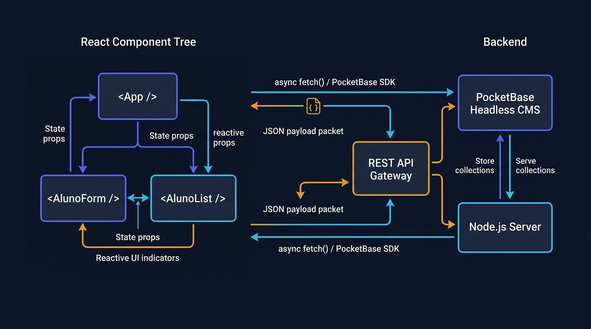

# Aula 02: Soluções de Gerenciamento de Conteúdo (PocketBase Headless CMS) e Prototipagem No-Code (v0 / Figma)



## 1. Objetivos de Aprendizagem

Ao concluir esta aula assíncrona, você será capaz de:
- [x] **Explicar** a arquitetura **Headless CMS** e como o **PocketBase** substitui sistemas acoplados tradicionais, fornecendo conteúdo rico via JSON e upload de mídias.
- [x] **Elaborar** prompts visuais/estruturais para ferramentas de **UI Generativa (`v0` / Figma-to-Code)** gerarem componentes React acessíveis e responsivos.
- [x] **Conectar** os componentes gerados ao esquema de coleções do PocketBase.

---

## 2. Fundamentação Teórica (Markdown)

### 2.1 O que é um Headless CMS e por que usar o PocketBase?
Em um CMS monolítico tradicional (como WordPress clássico), o painel de administração e os templates de front-end estão fundidos no mesmo servidor. Em uma arquitetura **Headless CMS ("Sem Cabeça")**, o gerenciador de conteúdo armazena os artigos, editais, banners e arquivos e os expõe puramente via **API REST/JSON**.

O **PocketBase** funciona como um Headless CMS perfeito para projetos em **React**:
- Possui campos nativos do tipo `Editor` (Rich Text HTML), `File` (com geração automática de *thumbnails* de imagens como `?thumb=300x200`) e `Relation`.
- A coordenação do curso atualiza um edital pelo painel administrativo visual do PocketBase e o portal em React reflete a mudança instantaneamente sem precisar recompilar código!

### 2.2 UI Generativa (`v0`, Figma-to-Code e Vibe Coding no Front-end)
Ferramentas de UI Generativa recebem a especificação dos campos de uma coleção do PocketBase e geram imediatamente a árvore de componentes React com layouts em CSS Grid/Flexbox, estados vazios (*Empty States*) e esqueletos de carregamento (*Skeletons*).

---

## 3. Atividade Prática Guiada (Hands-on)

### Passo 1: Prompt para Geração de Componente React (UI Generativa `v0`)
```text
[SPEC-PROMPT]: Gere um componente React <MuralEditaisIFCE /> estilizado em modo escuro que consuma a coleção "editais" do PocketBase (campos: id, titulo, categoria, data_publicacao, anexo_pdf) e construa a URL pública de download do arquivo anexo via /api/files/editais/:id/:filename.
```

### Passo 2: Utilitário de Mídia e Headless CMS para PocketBase + React

```javascript
// src/frontend/pocketbaseCmsHelper.js
export function construirUrlArquivoPocketBase(baseUrl, record, nomeArquivo, thumb = '') {
  if (!record || !record.collectionId || !record.id || !nomeArquivo) return null;
  const base = baseUrl.replace(/\/$/, '');
  const sufixoThumb = thumb ? `?thumb=${encodeURIComponent(thumb)}` : '';
  return `${base}/api/files/${record.collectionId}/${record.id}/${nomeArquivo}${sufixoThumb}`;
}

export function formatarEditalParaComponente(record, baseUrl = 'http://127.0.0.1:8090') {
  return {
    id: record.id,
    titulo: record.titulo,
    categoria: record.categoria || 'Acadêmico',
    resumo: record.resumo || '',
    urlPdf: record.anexo_pdf
      ? construirUrlArquivoPocketBase(baseUrl, record, record.anexo_pdf)
      : null
  };
}
```

### Passo 3: Teste de Validação
Verifique se `construirUrlArquivoPocketBase('http://127.0.0.1:8090', { collectionId: 'pbc_editais', id: 'rec123' }, 'edital.pdf')` produz exatamente `http://127.0.0.1:8090/api/files/pbc_editais/rec123/edital.pdf`.

---

## 4. Especificação de Ativos Visuais

### Prompt de Imagem (`DW3-U03-DIAG01`)
```text
[TIPO]: DIAG
[TEMA]: React Front-end API Integration & PocketBase Headless CMS
[ESTILO]: Modern minimalist tech vector illustration, clean lines, dark mode background (#0F172A), vibrant accent colors (#6366F1, #F59E0B).
[COMPOSIÇÃO]: Technical vector flow diagram illustrating a reactive React Component tree on the left, consuming JSON payload via async Fetch API from a central REST API Gateway, connected to a PocketBase Headless CMS and Node.js Server on the right.
[TEXT RENDERING]: Crisp legible text rendering for labels: "React Tree", "REST Gateway", "PocketBase CMS".
[ASPECT RATIO]: 16:9
```
