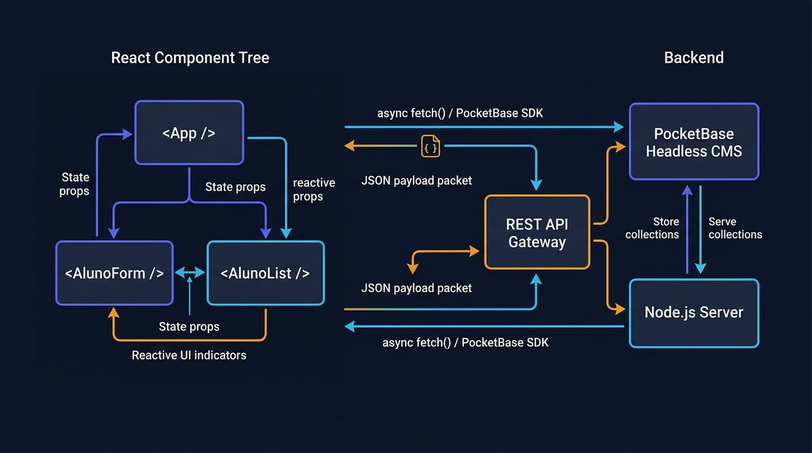

# Aula 03: Integração do Front-end React com APIs RESTful e Gerenciamento de Estado



## 1. Objetivos de Aprendizagem

Ao concluir esta aula síncrona, você será capaz de:
- [x] **Aplicar** os hooks essenciais do React (`useState` e `useEffect`) para sincronizar a interface com servidores externos (**Node.js** e **PocketBase**).
- [x] **Evitar** loops infinitos de renderização compreendendo o array de dependências do `useEffect`.
- [x] **Implementar** a máquina de estados da interface (`idle` → `loading` → `success` | `error`).

---

## 2. Fundamentação Teórica (Markdown)

### 2.1 Hooks Fundamentais no React: `useState` e `useEffect`
1. **`useState(valorInicial)`**: Preserva o estado reativo entre renderizações. Ao invocar a função atualizadora (`setAlunos(novosAlunos)`), o React agenda uma nova renderização da árvore visual.
2. **`useEffect(efeito, [dependencias])`**: Executa efeitos colaterais fora do cálculo puro de renderização (como buscar a lista de discentes na API Node.js/PocketBase assim que o componente é montado na tela).

### 2.2 A Tríade de Estado de Rede (`dados`, `carregando`, `erro`)
Uma interface profissional nunca deixa o usuário diante de uma tela em branco enquanto a rede responde. Todo componente que consome uma API deve gerenciar três variáveis reativas:
- `carregando` (`boolean`): Exibe um indicador visual (*Spinner* ou *Skeleton*).
- `erro` (`string | null`): Exibe um alerta amigável caso o servidor Node.js ou PocketBase esteja inacessível.
- `dados` (`Array`): Renderiza a lista ou um aviso de *"Nenhum registro encontrado"*.

---

## 3. Atividade Prática Guiada (Hands-on)

### Passo 1: Prompt de Especificação de Gerenciador de Estado Reativo
```text
[SPEC-PROMPT]: Crie um controlador de estado reativo em JavaScript/React (StoreAlunosReativo) que gerencie o estado { alunos, carregando, erro, filtroCurso }, permitindo buscar dados assíncronos da API e filtrar discentes em tempo real sem mutar o estado original.
```

### Passo 2: Implementação de Gerenciamento de Estado Imutável

```javascript
// src/code-samples/u3-react-frontend/estadoReativo.js
export function criarEstadoInicialAlunos() {
  return {
    alunos: [],
    carregando: false,
    erro: null,
    termoBusca: ''
  };
}

export function reducerAlunos(estadoAtual, acao) {
  switch (acao.tipo) {
    case 'REQUISICAO_INICIADA':
      return { ...estadoAtual, carregando: true, erro: null };
    case 'REQUISICAO_SUCESSO':
      return { ...estadoAtual, carregando: false, alunos: acao.payload, erro: null };
    case 'REQUISICAO_ERRO':
      return { ...estadoAtual, carregando: false, erro: acao.mensagem };
    case 'ATUALIZAR_BUSCA':
      return { ...estadoAtual, termoBusca: acao.termo };
    case 'ADICIONAR_ALUNO':
      return { ...estadoAtual, alunos: [...estadoAtual.alunos, acao.aluno] };
    default:
      return estadoAtual;
  }
}
```

### Passo 3: Teste de Validação
Confirme que o `reducerAlunos` utiliza o operador *spread* (`...estadoAtual`) para retornar sempre uma **nova referência de objeto**, requisito indispensável para que o React detecte a mudança e re-renderize a tela.

---

## 4. Especificação de Ativos Visuais

### Prompt de Imagem (`DW3-U03-DIAG01`)
```text
[TIPO]: DIAG
[TEMA]: Ciclo de Vida de Requisições Assíncronas com useState e useEffect no React
[ESTILO]: Modern minimalist tech vector illustration, clean lines, dark mode background (#0F172A), vibrant accent colors (#6366F1, #F59E0B).
[COMPOSIÇÃO]: Flow diagram connecting React Component state (loading, data, error) with REST API Gateway and PocketBase backend.
[TEXT RENDERING]: Crisp legible text rendering for labels: "useState", "useEffect", "PocketBase API".
[ASPECT RATIO]: 16:9
```
