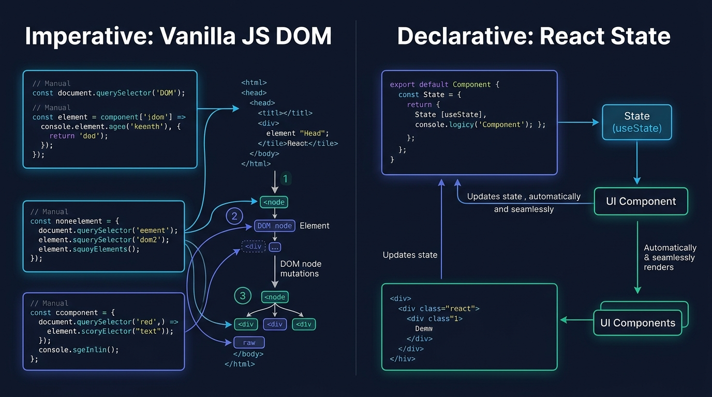

# Aula 04: Requisições Assíncronas (`fetch` / SDK `pocketbase`) e Manipulação de Estado Reativo



## 1. Objetivos de Aprendizagem

Ao concluir esta aula assíncrona, você será capaz de:
- [x] **Realizar** requisições `GET`, `POST` e `DELETE` utilizando a `Fetch API` nativa do JavaScript com `async/await` e `AbortController`.
- [x] **Construir** formulários controlados (*Controlled Components*) em React para cadastro de discentes.
- [x] **Subscrever** atualizações em tempo real (*Realtime SSE*) do **PocketBase** para atualizar a lista automaticamente quando outro usuário insere dados.

---

## 2. Fundamentação Teórica (Markdown)

### 2.1 Fetch API Nativa vs. SDK Oficial `pocketbase`
No **JavaScript Vanilla** e no **React** moderno, não precisamos instalar bibliotecas legadas para requisições simples: a **`fetch()` API** é nativa tanto no navegador quanto no Node.js 18+.

Quando nos conectamos ao **PocketBase**, podemos usar tanto `fetch()` direto quanto o SDK leve `pocketbase`, que adiciona conveniências poderosas como subscrição em tempo real com apenas 3 linhas de código:
```javascript
// Escuta qualquer criação ou edição na coleção 'alunos' em tempo real!
pb.collection('alunos').subscribe('*', (evento) => {
  console.log('Ação em tempo real:', evento.action, evento.record);
});
```

---

## 3. Atividade Prática Guiada (Hands-on)

### Passo 1: Prompt de Especificação de Serviço de Rede e Formulário Controlado
```text
[SPEC-PROMPT]: Escreva uma função assíncrona cadastrarAlunoViaFetch(apiUrl, dadosAluno, fetchFn) que envie um POST JSON com tratamento de erro HTTP, e uma função de validação de formulário controlado para React que habilite o botão de envio apenas quando o nome (>=3 letras) e matrícula (10 dígitos) forem válidos.
```

### Passo 2: Implementação de Requisição Assíncrona e Validação Reativa

```javascript
// src/code-samples/u3-react-frontend/clienteApiReact.js
export function validarFormularioAluno({ nome = '', matricula = '' }) {
  const erros = {};
  if (nome.trim().length < 3) {
    erros.nome = 'Informe no mínimo 3 caracteres.';
  }
  if (!/^\d{10}$/.test(String(matricula))) {
    erros.matricula = 'A matrícula deve ter exatamente 10 dígitos.';
  }
  return {
    valido: Object.keys(erros).length === 0,
    erros
  };
}

export async function enviarNovoAlunoFetch(apiUrl, payload, fetchFn = fetch) {
  const validacao = validarFormularioAluno(payload);
  if (!validacao.valido) {
    throw new Error(Object.values(validacao.erros).join(' '));
  }

  const res = await fetchFn(`${apiUrl}/alunos`, {
    method: 'POST',
    headers: { 'Content-Type': 'application/json' },
    body: JSON.stringify(payload)
  });

  const dados = await res.json();
  if (!res.ok) {
    throw new Error(dados.erro || dados.detail || `Erro HTTP ${res.status}`);
  }
  return dados;
}
```

### Passo 3: Teste de Validação
Teste `validarFormularioAluno({ nome: 'Li', matricula: '123' })` e confirme que `valido` é `false` antes mesmo de disparar tráfego de rede desnecessário.

---

## 4. Especificação de Ativos Visuais

### Prompt de Imagem (`DW3-U03-INFO01`)
```text
[TIPO]: INFO
[TEMA]: Formulários Controlados e Subscrição Realtime React + PocketBase
[ESTILO]: Modern minimalist tech vector illustration, clean lines, dark mode background (#0F172A), vibrant accent colors (#38BDF8, #818CF8, #34D399).
[COMPOSIÇÃO]: Infographic contrasting manual DOM input reading with Controlled React Forms and Realtime PocketBase updates.
[TEXT RENDERING]: Crisp legible text rendering for labels: "Imperative Vanilla JS DOM", "Declarative React State".
[ASPECT RATIO]: 16:9
```
