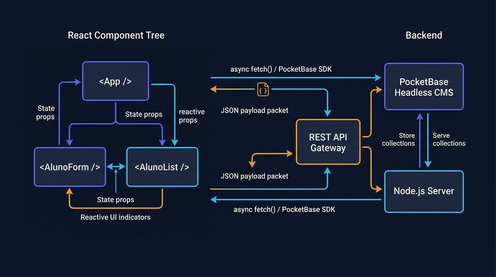

# Aula 05: Laboratório Prático: Consumo de Dados e Renderização Dinâmica na Interface React



## 1. Objetivos de Aprendizagem

Ao concluir este laboratório presencial de 4 horas da Unidade III, você será capaz de:
- [x] **Integrar** ponta a ponta o front-end **React** com a API **Node.js** e as coleções do **PocketBase**.
- [x] **Implementar** filtragem instantânea de discentes por nome ou matrícula usando estado derivado.
- [x] **Calcular** e renderizar cartões de indicadores acadêmicos (Total de Alunos, Taxa de Aprovação e Média da Turma).

---

## 2. Fundamentação Teórica (Markdown)

### 2.1 Estado Derivado (*Derived State*) no React
Um erro comum ao iniciar no React é criar múltiplos `useState` redundantes (por exemplo, um estado para `alunos`, outro para `alunosFiltrados` e outro para `totalAprovados`). Na arquitetura limpa em React, mantemos na memória apenas a **fonte única da verdade** (`alunos` e `termoBusca`) e calculamos os dados filtrados e as estatísticas dinamicamente durante a renderização.

---

## 3. Atividade Prática Guiada (Hands-on)

### Passo 1: Prompt de Especificação do Dashboard Acadêmico
```text
[SPEC-PROMPT]: Gere o módulo de lógica de apresentação de um Dashboard em React (calcularResumoDashboard e filtrarAlunosReativo) que filtre discentes por nome ou matrícula (case-insensitive) e retorne os KPIs da turma (total, aprovados, em exame final e média geral).
```

### Passo 2: Implementação da Lógica do Dashboard React (`src/code-samples/u3-react-frontend/`)

```javascript
// src/code-samples/u3-react-frontend/dashboardLogica.js
export function filtrarAlunosReativo(alunos = [], termoBusca = '') {
  const termo = termoBusca.trim().toLowerCase();
  if (!termo) return alunos;
  return alunos.filter(
    (a) =>
      a.nome.toLowerCase().includes(termo) ||
      String(a.matricula).includes(termo) ||
      (a.curso && a.curso.toLowerCase().includes(termo))
  );
}

export function calcularResumoDashboard(alunos = []) {
  const total = alunos.length;
  if (total === 0) {
    return { total: 0, aprovados: 0, emExame: 0, reprovados: 0, mediaTurma: 0 };
  }

  let somaMedias = 0;
  let aprovados = 0;
  let emExame = 0;
  let reprovados = 0;

  for (const aluno of alunos) {
    const media = Number(aluno.mediaXs ?? 0);
    somaMedias += media;
    if (aluno.situacao === 'APROVADO_POR_MEDIA') aprovados++;
    else if (aluno.situacao === 'EXAME_FINAL_EFP') emExame++;
    else reprovados++;
  }

  return {
    total,
    aprovados,
    emExame,
    reprovados,
    mediaTurma: Number((somaMedias / total).toFixed(2))
  };
}
```

### Passo 3: Roteiro de Validação em Laboratório
1. Carregar os discentes da API no Dashboard.
2. Digitar parte da matrícula no campo de busca e verificar a atualização instantânea da lista e dos contadores.
3. Cadastrar um novo aluno pelo modal e observar a inserção imediata sem recarregar a página (`F5`).

---

## 4. Especificação de Ativos Visuais

### Prompt de Imagem (`DW3-U03-DIAG01`)
```text
[TIPO]: DIAG
[TEMA]: Arquitetura do Dashboard Acadêmico Reativo em React + Node.js + PocketBase
[ESTILO]: Modern minimalist tech vector illustration, clean lines, dark mode background (#0F172A), vibrant accent colors (#6366F1, #F59E0B).
[COMPOSIÇÃO]: Component hierarchy showing Dashboard KPIs, SearchBar, AlunoTable, and ModalForm communicating with Node.js API and PocketBase.
[TEXT RENDERING]: Crisp legible text rendering for labels: "React Dashboard", "Derived State", "PocketBase".
[ASPECT RATIO]: 16:9
```
