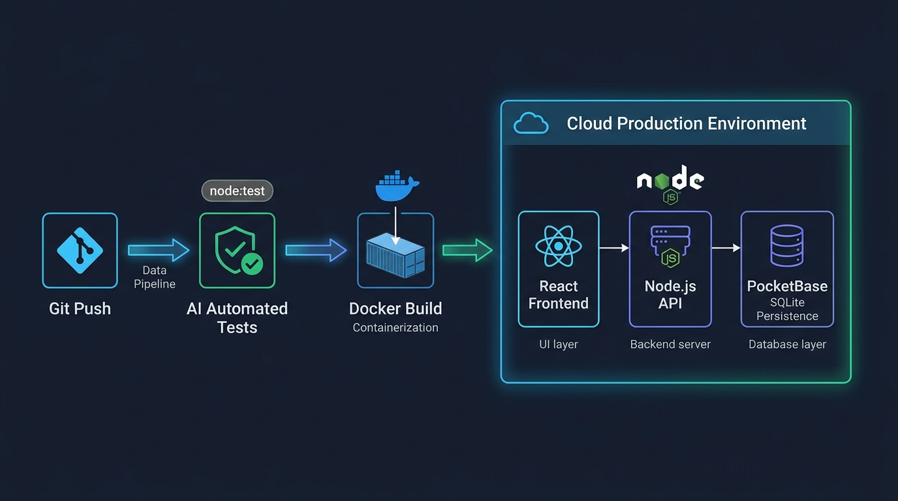

# Aula 03: Camada de Persistência no PocketBase/Node.js, Autenticação e Segurança da Informação



## 1. Objetivos de Aprendizagem

Ao concluir esta aula assíncrona, você será capaz de:
- [x] **Implementar** o fluxo de autenticação com **JSON Web Tokens (JWT)** integrando **React**, **Node.js** e **PocketBase**.
- [x] **Sanitizar** dados de entrada e saída para mitigar ataques de *Cross-Site Scripting (XSS)* e injeção.
- [x] **Configurar** políticas restritivas de CORS e cabeçalhos HTTP de segurança.

---

## 2. Fundamentação Teórica (Markdown)

### 2.1 Fluxo de Autenticação JWT Full-Stack (React ↔ PocketBase ↔ Node.js)
1. O usuário envia e-mail e senha no formulário **React** para `pb.collection('users').authWithPassword(email, senha)`.
2. O **PocketBase** valida o hash `bcrypt` e retorna um **Token JWT** assinado junto aos dados do perfil (`record`).
3. Nas chamadas subsequentes à API **Node.js** ou ao próprio **PocketBase**, o cliente envia o cabeçalho `Authorization: Bearer <token_jwt>`.
4. O servidor verifica a assinatura e a expiração do token antes de autorizar a operação.

### 2.2 Prevenção às Vulnerabilidades OWASP Top 10
- **A01 — Broken Access Control**: Nunca confie apenas em esconder botões no React; valide permissões no servidor Node.js e nas *API Rules* do PocketBase.
- **A03 — Injection & XSS**: Escape caracteres especiais HTML (`<`, `>`, `&`, `"`, `'`) sempre que renderizar strings em **JavaScript Vanilla**, e evite `dangerouslySetInnerHTML` no **React**.

---

## 3. Atividade Prática Guiada (Hands-on)

### Passo 1: Prompt de Especificação de Sanitização XSS e Verificação de Token
```text
[SPEC-PROMPT]: Crie em JavaScript ES6+ uma função escaparHtmlXSS(texto) para prevenir ataques Cross-Site Scripting e um middleware extrairBearerToken(authorizationHeader) que valide a estrutura de um token JWT no servidor Node.js.
```

### Passo 2: Implementação de Utilitários de Segurança

```javascript
// src/seguranca/authSecurity.js
export function escaparHtmlXSS(input) {
  return String(input ?? '')
    .replace(/&/g, '&amp;')
    .replace(/</g, '&lt;')
    .replace(/>/g, '&gt;')
    .replace(/"/g, '&quot;')
    .replace(/'/g, '&#39;');
}

export function extrairBearerToken(authHeader) {
  if (!authHeader || typeof authHeader !== 'string' || !authHeader.startsWith('Bearer ')) {
    const err = new Error('Token de autenticação ausente ou malformado.');
    err.statusCode = 401;
    throw err;
  }
  const token = authHeader.slice(7).trim();
  const partesJwt = token.split('.');
  if (partesJwt.length !== 3) {
    const err = new Error('Estrutura de token JWT inválida.');
    err.statusCode = 401;
    throw err;
  }
  return token;
}
```

### Passo 3: Teste de Validação
Passe `<script>alert("hack")</script>` para `escaparHtmlXSS` e verifique se as tags são neutralizadas em `&lt;script&gt;...`.

---

## 4. Especificação de Ativos Visuais

### Prompt de Imagem (`DW3-U04-DIAG01`)
```text
[TIPO]: DIAG
[TEMA]: Autenticação JWT e Camadas de Segurança OWASP entre React, Node.js e PocketBase
[ESTILO]: Modern minimalist tech vector illustration, clean lines, dark mode background (#0F172A), vibrant accent colors (#38BDF8, #818CF8, #34D399).
[COMPOSIÇÃO]: Security architecture diagram showing Bearer JWT token flow and XSS/Injection sanitization shields.
[TEXT RENDERING]: Crisp legible text rendering for labels: "JWT Auth", "Node.js API", "PocketBase SQLite".
[ASPECT RATIO]: 16:9
```
