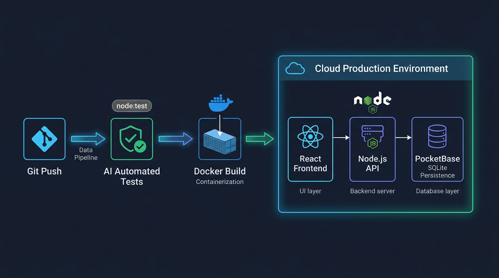

# Aula 04: Padrões Avançados de Arquitetura Full-Stack e Integração de Sistemas



## 1. Objetivos de Aprendizagem

Ao concluir esta aula síncrona, você será capaz de:
- [x] **Aplicar** o padrão **BFF (Backend for Frontend)** com Node.js agregando dados de múltiplas coleções do **PocketBase** para o **React**.
- [x] **Implementar** a regra completa de cálculo pós-Exame Final ($X_F = \frac{X_S + EFP}{2}$) conforme a Seção 5.1 do plano pedagógico do IFCE.
- [x] **Garantir** consistência transacional na consolidação de notas.

---

## 2. Fundamentação Teórica (Markdown)

### 2.1 O Padrão BFF (Backend for Frontend) com Node.js e PocketBase
Em telas complexas de fechamento de semestre, o front-end **React** precisa exibir simultaneamente dados do aluno, notas parciais ($AD$ e $AP$), nota de Exame Final ($EFP$), estatísticas da turma e situação final. Em vez de o React fazer 5 requisições separadas ao banco, o servidor **Node.js** atua como um **BFF**: busca os registros necessários no **PocketBase**, executa as fórmulas matemáticas oficiais do ROD/IFCE e entrega um único payload JSON pronto para a tela.

---

## 3. Atividade Prática Guiada (Hands-on)

### Passo 1: Prompt de Especificação do Cálculo Pós-Exame Final (ROD/IFCE)
```text
[SPEC-PROMPT]: Implemente em JavaScript ES6+ a função calcularResultadoFinalPosExame(mediaXs, notaEFP) seguindo a regra oficial do IFCE: Xf = (Xs + EFP) / 2, aprovando o estudante em exame final se Xf >= 5.0.
```

### Passo 2: Implementação Completa da Regra Pós-Exame (`EFP`)

```javascript
// src/code-samples/u2-pocketbase-orm/pocketbase-client.js (Consolidação Final)
export function calcularResultadoFinalPosExame(mediaXs, notaEFP) {
  const xs = Number(mediaXs);
  const efp = Number(notaEFP);

  if (Number.isNaN(xs) || xs < 3.0 || xs >= 6.0) {
    throw new Error('Apenas estudantes com Média Semestral entre 3.0 e 5.9 realizam Exame Final (EFP).');
  }
  if (Number.isNaN(efp) || efp < 0 || efp > 10) {
    throw new Error('A nota do Exame Presencial Final (EFP) deve estar entre 0.0 e 10.0.');
  }

  const mediaXf = Number(((xs + efp) / 2).toFixed(2));
  const situacaoFinal = mediaXf >= 5.0 ? 'APROVADO_POS_EXAME' : 'REPROVADO_POS_EXAME';

  return { mediaXs: xs, notaEFP: efp, mediaXf, situacaoFinal };
}
```

### Passo 3: Teste de Validação
Verifique que um discente com `mediaXs = 4.4` que obtém `notaEFP = 6.0` atinge `mediaXf = 5.2` e recebe status `'APROVADO_POS_EXAME'`.

---

## 4. Especificação de Ativos Visuais

### Prompt de Imagem (`DW3-U04-DIAG01`)
```text
[TIPO]: DIAG
[TEMA]: Arquitetura BFF (Backend for Frontend) com React, Node.js e PocketBase
[ESTILO]: Modern minimalist tech vector illustration, clean lines, dark mode background (#0F172A), vibrant accent colors (#38BDF8, #818CF8, #34D399).
[COMPOSIÇÃO]: Full-stack integration diagram showing React UI requesting consolidated report from Node.js BFF connected to PocketBase SQLite.
[TEXT RENDERING]: Crisp legible text rendering for labels: "React Frontend", "Node.js API", "PocketBase SQLite".
[ASPECT RATIO]: 16:9
```
