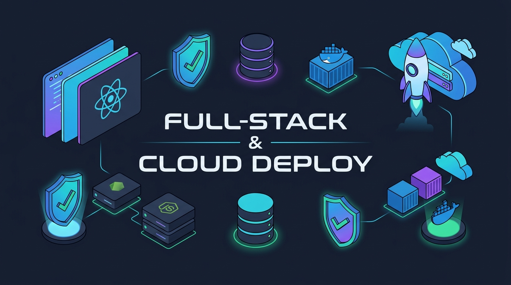

# Aula 05: Codificação Supervisionada do Projeto Final



## 1. Objetivos de Aprendizagem

Ao concluir esta etapa assíncrona de codificação supervisionada, você será capaz de:
- [x] **Organizar** o repositório Full-Stack com diretórios claros para o back-end **Node.js**, configurações do **PocketBase** (`pb_migrations`) e front-end **React**.
- [x] **Aplicar** o padrão *Conventional Commits* (`feat:`, `fix:`, `test:`, `docs:`) em entregas incrementais.
- [x] **Validar** a integração local entre as 3 camadas da aplicação.

---

## 2. Fundamentação Teórica (Markdown)

### 2.1 Fluxo de Trabalho Profissional com Git e Vibe Coding Iterativo
Durante a codificação do Projeto Final, evite pedir que a IA gere todo o sistema de uma só vez. Trabalhe em fatias verticais pequenas (*Vertical Slices*):
1. **Slice 1 (Persistência)**: Crie a coleção no PocketBase e valide pelo painel Admin.
2. **Slice 2 (Regra de Negócio Node.js)**: Implemente o serviço/endpoint e rode o teste unitário.
3. **Slice 3 (Componente React)**: Construa a tela consumindo o endpoint e faça um commit semântico (`feat(matriculas): adiciona listagem e filtro de alunos no dashboard`).

---

## 3. Atividade Prática Guiada (Hands-on)

### Passo 1: Prompt para Validador de Padronização de Commits e Variáveis de Ambiente
```text
[SPEC-PROMPT]: Escreva uma função em JavaScript validarCommitConvencional(mensagem) que valide se a mensagem de commit segue a especificação Conventional Commits (feat, fix, docs, test, refactor, chore) exigida na avaliação do Projeto Final.
```

### Passo 2: Validador de Qualidade de Repositório

```javascript
// src/projeto/gitQualityValidator.js
const REGEX_CONVENTIONAL_COMMIT = /^(feat|fix|docs|style|refactor|test|chore)(\([a-z0-9-]+\))?:\s.{5,100}$/;

export function validarCommitConvencional(mensagem) {
  const msg = String(mensagem ?? '').trim();
  const valido = REGEX_CONVENTIONAL_COMMIT.test(msg);
  return {
    valido,
    mensagem: valido
      ? 'Commit semântico válido.'
      : 'Use o formato: tipo(escopo): descrição (ex.: feat(api): implementa rota de alunos)'
  };
}
```

### Passo 3: Teste de Validação
Confirme que `validarCommitConvencional('feat(pocketbase): configura regras de acesso da colecao alunos')` retorna `{ valido: true }`.

---

## 4. Especificação de Ativos Visuais

### Prompt de Imagem (`DW3-U04-ART01`)
```text
[TIPO]: ART
[TEMA]: Desenvolvimento Full-Stack Supervisionado com Git, React, Node.js e PocketBase
[ESTILO]: Modern minimalist tech vector illustration, clean lines, dark mode background (#0F172A), vibrant accent colors (#38BDF8, #A855F7, #34D399).
[COMPOSIÇÃO]: Full-stack developer workflow showing Git branches, React UI components, Node.js server, and PocketBase storage.
[TEXT RENDERING]: Crisp legible text rendering for labels: "FULL-STACK & CLOUD DEPLOY".
[ASPECT RATIO]: 16:9
```
