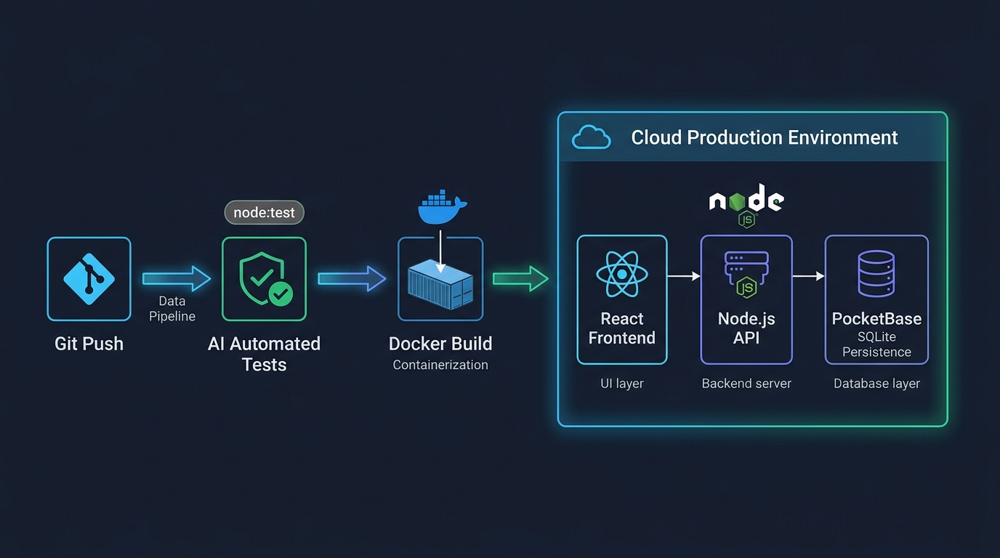

# Aula 06: Testes Automatizados Gerados por IA (`node:test`) e Estratégias de Deploy



## 1. Objetivos de Aprendizagem

Ao concluir esta aula assíncrona, você será capaz de:
- [x] **Escrever** testes unitários e de integração utilizando o executor de testes nativo do Node.js (`node:test` e `node:assert/strict`) com auxílio de IA.
- [x] **Criar** um `Dockerfile` multi-stage otimizado para publicar a aplicação em nuvem.
- [x] **Selecionar** a estratégia de hospedagem adequada para cada camada (Vercel para **React**, Render/Fly.io para **Node.js** e **PocketBase** com volume persistente para `pb_data`).

---

## 2. Fundamentação Teórica (Markdown)

### 2.1 Testes Automatizados Nativos em Node.js (`node:test`) com IA
O Node.js 20+ inclui um *test runner* nativo ultrarrápido (`node --test`), dispensando configurações complexas de pacotes externos. Com a abordagem **SDD + Vibe Coding**, fornecemos a especificação de uma função ao assistente de IA e solicitamos uma bateria de testes cobrindo:
- **Caminho Feliz (*Happy Path*)**: Entradas válidas gerando o resultado esperado.
- **Casos de Borda (*Edge Cases*)**: Limites exatos (ex.: média `6.0`, frequência `75.0%`).
- **Casos de Erro**: Matrículas inválidas, duplicidades e acessos não autorizados (`assert.throws`).

### 2.2 Containerização e Deploy de PocketBase + Node.js + React
Ao publicar o **PocketBase** em nuvem (Fly.io, Render ou Railway), um cuidado arquitetural é indispensável: como o banco SQLite e os uploads ficam salvos no diretório `pb_data/`, é obrigatório montar um **Volume Persistente (Persistent Volume)** nesse diretório para que os dados sobrevivam a novos deploys do container Docker.

---

## 3. Atividade Prática Guiada (Hands-on)

### Passo 1: Prompt para Geração de Suíte `node:test` e `Dockerfile`
```text
[SPEC-PROMPT]: Gere uma suíte de testes automatizados usando node:test e node:assert/strict que valide a API de Alunos (Node.js), o cálculo de médias do IFCE (PocketBase/ORM) e a filtragem reativa do Dashboard (React).
```

### Passo 2: Exemplo de Teste Nativo (`node:test`)

```javascript
// Exemplo executável em src/code-samples/u4-fullstack-tests/api.test.js
import { test, describe } from 'node:test';
import assert from 'node:assert/strict';
import { calcularMediaSemestralIFCE } from '../u2-pocketbase-orm/pocketbase-client.js';

describe('Validação Automatizada das Regras Acadêmicas IFCE (ROD)', () => {
  test('Deve aprovar por média quando Xs >= 6.0 e frequência >= 75%', () => {
    const res = calcularMediaSemestralIFCE(8.0, 7.0, 85);
    assert.equal(res.mediaXs, 7.4);
    assert.equal(res.situacao, 'APROVADO_POR_MEDIA');
  });

  test('Deve encaminhar para Exame Final (EFP) quando 3.0 <= Xs < 6.0', () => {
    const res = calcularMediaSemestralIFCE(5.0, 4.0, 80);
    assert.equal(res.mediaXs, 4.4);
    assert.equal(res.situacao, 'EXAME_FINAL_EFP');
  });
});
```

### Passo 3: Teste de Validação
Execute `npm test` (que aciona `node --test`) no terminal e confirme 100% de aprovação na suíte.

---

## 4. Especificação de Ativos Visuais

### Prompt de Imagem (`DW3-U04-DIAG01`)
```text
[TIPO]: DIAG
[TEMA]: CI/CD Pipeline, AI Automated Tests (node:test) & Cloud Deployment
[ESTILO]: Modern minimalist tech vector illustration, clean lines, dark mode background (#0F172A), vibrant accent colors (#38BDF8, #818CF8, #34D399).
[COMPOSIÇÃO]: Technical vector architecture diagram showing Git Push -> AI Automated Tests (node:test) -> Docker Build -> Cloud Production Environment hosting React Front-end, Node.js API, and PocketBase SQLite Persistence.
[TEXT RENDERING]: Crisp legible text rendering for labels: "Git Push", "AI Tests (node:test)", "Docker Build", "Cloud Production".
[ASPECT RATIO]: 16:9
```
