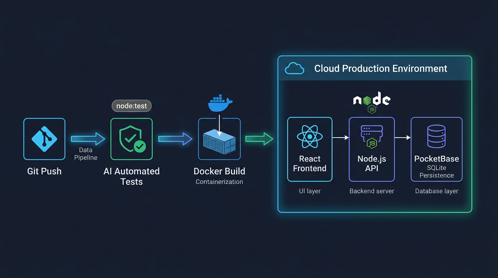

# Aula 07: Laboratório Prático: Publicação Prática (Deploy) e Testes de Carga Finais



## 1. Objetivos de Aprendizagem

Ao concluir este laboratório presencial de 4 horas, você será capaz de:
- [x] **Realizar** o deploy da aplicação Full-Stack e verificar a conectividade HTTPS entre **React**, **Node.js** e **PocketBase**.
- [x] **Implementar** uma rota de verificação de integridade (`/health`) que monitora o tempo de atividade (*uptime*) e a conexão com o banco.
- [x] **Executar** uma bateria de requisições concorrentes (`Promise.all`) para aferir a latência média (`p95`) e a estabilidade do servidor.

---

## 2. Fundamentação Teórica (Markdown)

### 2.1 Observabilidade, *Healthchecks* e Testes de Carga
Plataformas modernas de nuvem (Render, Fly.io, Railway) monitoram periodicamente uma rota de **Healthcheck** (`/health` ou `/api/health` no PocketBase) para saber se o container está saudável ou precisa ser reiniciado automaticamente. Além disso, antes de entregar o sistema aos usuários finais, simulamos rajadas de acessos simultâneos para garantir que o Event Loop do Node.js permaneça responsivo.

---

## 3. Atividade Prática Guiada (Hands-on)

### Passo 1: Prompt para Simulador de Carga e Healthcheck em Node.js
```text
[SPEC-PROMPT]: Crie em JavaScript ES6+ um avaliador de saúde e carga (executarTesteCargaConcorrente) que dispare N requisições assíncronas simultâneas via Promise.all contra uma função de handler da API, medindo o tempo total, taxa de sucesso e latência média por requisição.
```

### Passo 2: Implementação de Healthcheck e Teste de Carga

```javascript
// src/projeto/loadTester.js
import { performance } from 'node:perf_hooks';

export async function executarTesteCargaConcorrente(fnRequisicao, totalRequisicoes = 50) {
  const inicio = performance.now();
  const promessas = Array.from({ length: totalRequisicoes }, (_, i) => fnRequisicao(i));
  const resultados = await Promise.allSettled(promessas);
  const duracaoTotalMs = Number((performance.now() - inicio).toFixed(2));

  const sucessos = resultados.filter((r) => r.status === 'fulfilled').length;
  const falhas = totalRequisicoes - sucessos;

  return {
    totalRequisicoes,
    sucessos,
    falhas,
    duracaoTotalMs,
    latenciaMediaMs: Number((duracaoTotalMs / totalRequisicoes).toFixed(2)),
    estavel: falhas === 0
  };
}
```

### Passo 3: Teste de Validação em Laboratório
Execute `executarTesteCargaConcorrente` com 50 chamadas simultâneas e verifique se `estavel === true` e `falhas === 0`.

---

## 4. Especificação de Ativos Visuais

### Prompt de Imagem (`DW3-U04-DIAG01`)
```text
[TIPO]: DIAG
[TEMA]: Monitoramento de Healthcheck e Testes de Carga em Produção Cloud
[ESTILO]: Modern minimalist tech vector illustration, clean lines, dark mode background (#0F172A), vibrant accent colors (#38BDF8, #818CF8, #34D399).
[COMPOSIÇÃO]: Production cloud cluster receiving concurrent load test requests with healthcheck status indicators.
[TEXT RENDERING]: Crisp legible text rendering for labels: "Docker Build", "Cloud Production", "PocketBase SQLite".
[ASPECT RATIO]: 16:9
```
