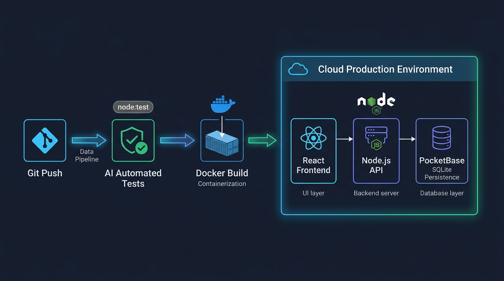

# Aula 09: Envio Final do Repositório do Projeto no AVA Moodle (2ª Atividade Avaliativa)



## 1. Objetivos de Aprendizagem

Ao concluir esta atividade avaliativa assíncrona, você será capaz de:
- [x] **Elaborar** um documento `README.md` de nível profissional contendo arquitetura, instruções de execução do **Node.js**, **PocketBase** e **React**, e evidências de testes.
- [x] **Executar** o checklist final de conformidade antes da submissão no AVA Moodle.
- [x] **Realizar** o envio oficial do link do repositório GitHub/GitLab e da URL de deploy.

---

## 2. Fundamentação Teórica (Markdown)

### 2.1 Anatomia de uma Entrega de Software Profissional
Um projeto sem documentação clara não pode ser auditado nem mantido. Para a **2ª Atividade Avaliativa (Projeto Final)** no Moodle do IFCE *Campus* Baturité, o repositório deve conter obrigatoriamente:
1. **`README.md` Completo**: Descrição do projeto, stack tecnológica (`JS Vanilla`, `Node.js`, `PocketBase`, `React`), passo a passo para rodar localmente e link do ambiente em nuvem.
2. **Arquivo `.env.example`**: Documentando todas as variáveis de ambiente necessárias (sem expor segredos reais!).
3. **Exportação do Schema do PocketBase (`pb_schema.json` ou `pb_migrations/`)**: Permitindo que o professor recrie as coleções e *API Rules* com um único comando.
4. **Suíte de Testes Automatizados (`npm test`)**: Executando sem erros.

---

## 3. Atividade Prática Guiada (Hands-on)

### Passo 1: Prompt para Verificador de Entrega Final no Moodle
```text
[SPEC-PROMPT]: Gere uma função verificarChecklistEntregaMoodle(entrega) em JavaScript que valide se o pacote de submissão do aluno possui urlRepositorioGit, urlDeployNuvem, possuiEnvExample, possuiSchemaPocketBase e testesPassando.
```

### Passo 2: Validador de Submissão do Projeto Final

```javascript
// src/projeto/checklistEntregaMoodle.js
export function verificarChecklistEntregaMoodle(entrega) {
  const pendencias = [];
  if (!entrega?.urlRepositorioGit || !/^https?:\/\/(github|gitlab)\.com\/.+/.test(entrega.urlRepositorioGit)) {
    pendencias.push('URL válida do repositório GitHub ou GitLab é obrigatória.');
  }
  if (!entrega?.possuiEnvExample) {
    pendencias.push('O arquivo .env.example deve estar presente na raiz do repositório.');
  }
  if (!entrega?.possuiSchemaPocketBase) {
    pendencias.push('O schema/migrations do PocketBase (pb_schema.json) deve ser versionado.');
  }
  if (!entrega?.testesPassando) {
    pendencias.push('A suíte de testes automatizados (npm test) deve estar passando.');
  }

  return {
    prontoParaEnvioMoodle: pendencias.length === 0,
    pendencias
  };
}
```

### Passo 3: Teste de Validação
Execute a verificação sobre os metadados da sua entrega antes de clicar em **"Enviar tarefa"** no Moodle.

---

## 4. Especificação de Ativos Visuais

### Prompt de Imagem (`DW3-U04-DIAG01`)
```text
[TIPO]: DIAG
[TEMA]: Checklist de Entrega Contínua e Publicação Final no AVA Moodle
[ESTILO]: Modern minimalist tech vector illustration, clean lines, dark mode background (#0F172A), vibrant accent colors (#38BDF8, #818CF8, #34D399).
[COMPOSIÇÃO]: Verification pipeline from Git Repository and Automated Tests to Cloud Production and Moodle Submission.
[TEXT RENDERING]: Crisp legible text rendering for labels: "Git Push", "AI Tests (node:test)", "Cloud Production".
[ASPECT RATIO]: 16:9
```
